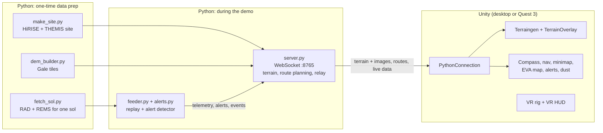

# Marsmap

**NASA Space Apps Challenge 2026 · Seattle · November 14–15, 2026**
**Challenge:** [Interplanetary Survival Guide: Martian Map](https://www.spaceappschallenge.org/2026/challenges/interplanetary-survival-guide-martian-map/)

A first-person **Marswalk** on real NASA terrain at Mount Sharp, Gale crater, with a helmet-style heads-up display: map layers, a compass and navigation readout, a route planner that steers around steep ground, and live radiation, UV and weather readings replayed from the Curiosity rover, with alerts when conditions turn dangerous. It runs on a desktop and in VR on a **Meta Quest 3**.

> **Demo:** our demo was recorded from the **`vr-quest`** branch, in VR on a Meta Quest 3.
> Video: *(add link)*

---

## What it does

**Terrain and map layers**
- You start where Curiosity actually stood on **sol 4560** (4 June 2025), on a 2 km patch of Mount Sharp built from a HiRISE terrain model, with the HiRISE colour photo draped over it.
- Switch layers: photo → slope hazards (caution 15–20°, no-go 20°+) → THEMIS thermal inertia (sand vs. rock) → height colours.
- Or load a much bigger area: the whole Gale crater region as a seamless grid of terrain tiles (USGS MOLA-HRSC + CTX elevation, THEMIS + CTX imagery).

**Navigation and route planning**
- Compass with arrows to the next waypoint (red) and Home Base (green), plus a readout of heading, pitch, latitude, longitude and elevation.
- A minimap that turns with you, coloured by slope hazard zones, with an "upcoming hills" elevation profile of the ground ahead.
- **EVA map:** a table-top hologram of the terrain. Drop waypoints on it and an A* planner routes you around ground steeper than 18° (climbs) or 25° (side slopes), with distance, Tobler hiking-time estimate and an EASY / MODERATE / HARD rating. On the ground a beam marks the next waypoint and a sphere marks Home Base.

**Live conditions and alerts**
- Real radiation (RAD), temperature, pressure and UV (REMS) from sol 4560, replayed at 300× (a 4-hour EVA in 48 seconds) in an environment panel.
- Alerts with beeps:
  - **dust storm early warning** from UV dimming and pressure dips;
  - **radiation**, using the RAD team's own solar-storm trigger and NASA's shelter level;
  - **UV index**, which on Mars is already above Earth's record when the EVA starts at 09:00 local time.
- A dust storm you can see: fog, orange tint and blowing dust.

**VR (Meta Quest 3)**
- Head tracking, left-stick walking, snap turn.
- The whole HUD on one head-locked panel, laid out like the desktop.
- The EVA map with a controller laser: tap the trigger to add a waypoint, hold and drag to turn the hologram.
- An offline mode so the headset needs no laptop.

### Real data vs. simulated

| | Source |
|---|---|
| Terrain, photo, slope, thermal, rover position | **Real** NASA / USGS data (HiRISE, THEMIS, MSL waypoints; CTX and MOLA-HRSC for the big map) |
| Radiation, temperature, pressure, UV | **Real** Curiosity RAD + REMS readings from sol 4560, time-compressed |
| Dust front and solar particle event | **Simulated**: scripted changes to the real readings, shaped on measured Mars events. The HUD labels them **SIMULATED** |
| Alert thresholds | From published sources: [docs/ALERTS.md](docs/ALERTS.md) |
| Earth message, navigation failure | Scripted demo events |

---

## Quick start (desktop)

You need **Unity 6000.6.9f1** (Unity 6.6), **Python 3.10+** and **Git LFS** (GitHub Desktop includes it).

```bash
# once, from the repo folder
python3 -m venv .venv
.venv/bin/pip install -r Python/requirements.txt
.venv/bin/pip install -r Python/requirements-maps.txt   # only for the big Gale map / regenerating data
```

1. Open the project in Unity and open `Assets/Scenes/GetStarted_Scene.unity`.
2. Start the server (terminal 1). Pick one:
   ```bash
   python3 Python/server.py --site        # the 2 km HiRISE site at Curiosity (used for the demo)
   python3 Python/server.py               # the whole Gale crater region, as terrain tiles
   ```
   The big map downloads data the first time and caches it. To skip that, unzip `gale_terrain_tiles.zip` in the repo folder: it holds a pre-built `Python/imagery_cache/`.
3. Press **Play** in Unity.
4. Start the EVA replay (terminal 2): `python3 Python/feeder.py`. Alerts and the dust storm arrive within 48 seconds.
   Preview them without Unity: `python3 Python/feeder.py --timeline`.

The scripts relaunch themselves inside `.venv`, so plain `python3` works.

## Quick start (VR, Meta Quest 3)

Build the Android app from this branch and install it over USB (Unity's **Build And Run**). The full, tested setup is in **[docs/VR_QUEST.md](docs/VR_QUEST.md)**, including the steps that are easy to miss.

- **Offline:** the terrain and the EVA replay are packed into the app, so the headset needs no laptop. Press **X** to start the EVA.
- **Live from the laptop:** start the server with `--host 0.0.0.0` *before* opening the app, and put the laptop's Wi-Fi address in `Assets/Resources/marsmap_config.json`.

## Controls

| Action | Desktop | Quest 3 |
|---|---|---|
| Walk | W A S D / arrow keys | Left stick (where you look) |
| Look / turn | Mouse | Head; right stick snap-turns 30° |
| Sprint | Hold Left Shift | Hold left grip |
| Jump | Space | Off by default (`allow_jump_in_vr`) |
| Next map layer | L | B |
| Test dust gust | G | Y |
| Start EVA (offline mode) | Enter | X |
| Minimap zoom / hazard colours | + / −, H | Right stick up / down |
| EVA map open / close | M | Menu button (left controller) |

**On the EVA map:**

| Action | Desktop | Quest 3 |
|---|---|---|
| Add waypoint | Click | Tap the trigger |
| Turn / tilt | Drag; Q / E | Hold the trigger and drag; right stick |
| Remove waypoint | Shift + click | Point at the pin, A |
| Zoom | Scroll | Right stick up / down |
| Move the area | W A S D / right-drag | Left stick |
| Top-down, centre on me, undo, clear, return home | T, F, Backspace, C, R | Panel buttons |

---

## How it works



- **Python** prepares NASA data and runs a local WebSocket server. It sends Unity the terrain and map images, plans routes, and relays the replayed telemetry and alerts.
- **Unity** builds the terrain at runtime and draws the HUD. In a headset the same scene switches to VR by itself.
- **Offline:** for the headset, `Python/export_offline.py` packs the server's messages into the app.

### Repo map

| Path | What's there |
|---|---|
| `Assets/Scenes/GetStarted_Scene.unity` | The one scene |
| `Assets/SourceFiles/Scripts/` | Unity scripts: connection, terrain, layers, movement, compass, nav, minimap, EVA map, alerts, dust, sky |
| `Assets/SourceFiles/Scripts/VR/` | VR rig, controller input, VR HUD, VR versions of the minimap / map / alerts, config |
| `Assets/Resources/marsmap_config.json` | Server address and VR settings |
| `Assets/StreamingAssets/Marsmap/` | Offline bundle for the headset (terrain + EVA replay) |
| `Python/` | Server, replay, alerts, route planner, data-prep scripts, data files ([Python/README.md](Python/README.md)) |
| `Python/Mars_mapping*.ipynb` | The team's route-planning and trail-recommender notebooks |
| `docs/` | Project report, alert system, VR guide |

---

## Data sources

- **HiRISE terrain model** `DTEEC_019698_1750_019988_1750_U01` (MRO; USGS Astrogeology): [STAC catalogue](https://stac.astrogeology.usgs.gov/browser-dev/#/api/collections/mro_hirise_socet_dtms)
- **HiRISE colour Gale mosaic** (MSL Gale merged orthophoto mosaic, USGS): [product page](https://astrogeology.usgs.gov/search/map/mars_msl_gale_merged_orthophoto_mosaic_25cm)
- **THEMIS thermal inertia** (Mars Odyssey): [mosaic 30S120E](https://astrogeology.usgs.gov/search/map/themis_thermal_inertia_mosaic_quantitative_30s120e_100mpp)
- **Curiosity position** (MSL waypoints, NASA/JPL MMGIS): [MSL_waypoints.json](https://mars.nasa.gov/mmgis-maps/MSL/Layers/json/MSL_waypoints.json)
- **Curiosity RAD** radiation data: [NASA PDS PPI](https://pds-ppi.igpp.ucla.edu/data/MSL-M-RAD-3-RDR-V1.0/)
- **Curiosity REMS** temperature, pressure and UV: [NASA PDS Atmospheres](https://atmos.nmsu.edu/PDS/data/mslrem_1001/)
- **Big Gale map:**
  - [MOLA-HRSC blended DEM, 200 m](https://asc-pds-services.s3.us-west-2.amazonaws.com/mosaic/Mars/HRSC_MOLA_Blend/Mars_HRSC_MOLA_BlendDEM_Global_200mp_v2.tif)
  - USGS CTX DTMs and orthoimages (via the [USGS STAC API](https://stac.astrogeology.usgs.gov/api/search))
  - THEMIS day IR
- **Alert thresholds and event shapes:** published RAD, REMS, Perseverance MEDA and NASA SRAG studies, listed in [docs/ALERTS.md](docs/ALERTS.md#sources)
- **[JMARS](https://jmars.asu.edu/)** (Arizona State University): scouting and CSV terrain exports

## The challenge, and how we answered it

NASA asked for a map, tool or interface a Mars astronaut could use to plan and carry out a Marswalk, built from NASA data. How we met each suggestion:

| NASA's suggestion | How we met it |
|---|---|
| Start from a science goal | Mount Sharp's boxwork-era terrain, at Curiosity's real position |
| Layer at least three data types | Optical, topographic, thermal, radiation, atmospheric |
| Astronaut safety | Slope hazard zones, routes that avoid steep ground, radiation, UV and dust alerts with actions to take |
| Pick a format | A helmet HUD, on desktop and in a VR headset |
| Look beyond Mars | Slope limits borrowed from Artemis lunar EVA planning |

The full checklist, with what's done and what isn't, is in [docs/PROJECT_REPORT.md §11](docs/PROJECT_REPORT.md#11-challenge-requirements-checklist).

## Documentation

- **[docs/PROJECT_REPORT.md](docs/PROJECT_REPORT.md):** how everything works and connects, every data source, the message protocol, the challenge checklist, known limitations.
- **[docs/ALERTS.md](docs/ALERTS.md):** the alert system: thresholds, the demo timeline, sources.
- **[docs/VR_QUEST.md](docs/VR_QUEST.md):** building and running on a Meta Quest 3.
- **[Python/README.md](Python/README.md):** the Python scripts, data files and commands.

## Team

Nate · Ahrial · Aiden · Aidan

## License

No licence file is included yet. Space Apps requires projects to be open source, so add one (for example MIT) before publishing. NASA and USGS data are public domain; credit the sources above when reusing them.
