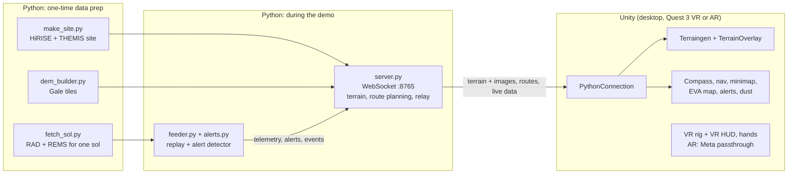

# Marsmap

**NASA (National Aeronautics and Space Administration) Space Apps Challenge 2026 · Seattle · November 14–15, 2026**
**Challenge:** [Interplanetary Survival Guide: Martian Map](https://www.spaceappschallenge.org/2026/challenges/interplanetary-survival-guide-martian-map/)

A first-person **Marswalk** on real NASA terrain at Mount Sharp, Gale crater, with a helmet-style heads-up display (HUD):
- map layers;
- a compass and navigation readout;
- a route planner that steers around steep ground;
- live radiation, ultraviolet (UV) and weather readings replayed from the Curiosity rover, with alerts when conditions turn dangerous.

It runs on a desktop and in virtual reality (VR) on a **Meta Quest 3**. An **augmented reality (AR) mode** shows the HUD and the map over your real room through the headset's passthrough cameras, and the map also works with hand tracking.

> **Demo videos** (recorded on a Meta Quest 3):
> - [Short demo: VR and AR](https://youtu.be/aZsskE2OMx4)
> - [Full walkthrough in VR](https://youtu.be/CJRw5Pc4I6o)

---

## Project status

The hackathon is over and this repository is kept as a **public demonstration**. It holds the whole project: the desktop version, the Meta Quest 3 VR version, AR mode and hand tracking, the F8 green screen and the licence.

The [VR guide](docs/VR_QUEST.md) covers both the VR and AR builds.

---

## What it does

**Terrain and map layers**
- **Where you start:** where Curiosity actually stood on **sol 4560** (4 June 2025). The ground is a 2 km patch of Mount Sharp built from a High Resolution Imaging Science Experiment (HiRISE) terrain model, with the HiRISE colour photo draped over it.
- **Layers:** switch between photo → slope hazards (caution 15–20°, no-go 20°+) → Thermal Emission Imaging System (THEMIS) thermal inertia (sand vs. rock) → height colours.
- **Bigger area:** load the whole Gale crater region instead, as a seamless grid of terrain tiles. The elevation comes from the U.S. Geological Survey (USGS): a MOLA-HRSC (Mars Orbiter Laser Altimeter and High Resolution Stereo Camera) blend plus Context Camera (CTX) terrain models. The imagery comes from THEMIS and CTX.

**Navigation and route planning**
- **Compass:** arrows to the next waypoint (red) and Home Base (green), plus a readout of heading, pitch, latitude, longitude and elevation.
- **Minimap:** it turns with you, is coloured by slope hazard zones, and has an "upcoming hills" elevation profile of the ground ahead.
- **Extravehicular activity (EVA) map:** a table-top hologram of the terrain. Drop waypoints on it, and an A* planner routes you around ground steeper than 18° (climbs) or 25° (side slopes).
  - **Route details:** distance, a Tobler hiking-time estimate, and an EASY / MODERATE / HARD rating.
  - **On the ground:** a beam marks the next waypoint and a sphere marks Home Base. On reaching a waypoint, the route quietly re-plans from where you stand.

**Live conditions and alerts**
- **Real readings:** radiation from Curiosity's Radiation Assessment Detector (RAD), and temperature, pressure and UV from its Rover Environmental Monitoring Station (REMS), all from sol 4560, replayed at 300× (a 4-hour EVA in 48 seconds).
- **Alerts with beeps:**
  - **dust storm early warning** from UV dimming and pressure dips;
  - **radiation**, using the RAD team's own solar-storm trigger and NASA's shelter level;
  - **UV index**, which on Mars is already above Earth's record when the EVA starts at 09:00 local time.
- **Environment panel** with the live readings, in the headset HUD.
- **A visible dust storm:** fog, orange tint and blowing dust.

**VR (Meta Quest 3)**
- Head tracking, left-stick walking, snap turn.
- The whole HUD on one head-locked panel, laid out like the desktop.
- **EVA map with a controller laser:** tap the trigger to add a waypoint, hold and drag to turn the hologram.
- **Hand tracking:** put the controllers down and use the map with your hands: hold your left palm up to open it, point and pinch to add waypoints, pinch with both hands to zoom.
- **Offline mode:** the headset needs no laptop.

**AR mode (Meta Quest 3)**
- **What you see:** your real room through the Quest 3's passthrough cameras, with the HUD on top. The Mars terrain, sky, dust and ground markers aren't drawn.
- **What stays:** the EVA map hologram (kept 30 cm above your real floor), route planning, the compass arrows, the minimap and the alerts all keep working.
- **Turning it on:** `"ar_passthrough": true` in `Assets/Resources/marsmap_config.json` (the committed setting), then rebuild; `false` gives the normal VR Marswalk. It uses Meta's extended reality (XR) software development kit (SDK), the Meta XR Core SDK; if passthrough can't start, the app stays in VR.

### Real data vs. simulated

| | Source |
|---|---|
| Terrain, photo, slope, thermal, rover position | **Real** NASA / USGS data (HiRISE, THEMIS, Mars Science Laboratory (MSL) waypoints; CTX and MOLA-HRSC for the big map) |
| Radiation, temperature, pressure, UV | **Real** Curiosity RAD + REMS readings from sol 4560, time-compressed |
| Dust front and solar particle event | **Simulated**: scripted changes to the real readings, shaped on measured Mars events. The HUD labels them **SIMULATED** |
| Alert thresholds | From published sources: [docs/ALERTS.md](docs/ALERTS.md) |
| Earth message, navigation failure | Scripted demo events |

---

## Quick start (desktop)

You need **Unity 6000.6.9f1** (Unity 6.6), **Python 3.10+** and **Git Large File Storage (LFS)** (GitHub Desktop includes it).

```bash
# once, from the repo folder
python3 -m venv .venv
.venv/bin/pip install -r Python/requirements.txt
.venv/bin/pip install -r Python/requirements-maps.txt   # only for the big Gale map / regenerating data
```

1. **Open the scene:** open the project in Unity, then open `Assets/Scenes/GetStarted_Scene.unity`.
2. **Start the server** (terminal 1). Pick one:
   ```bash
   python3 Python/server.py --site        # the 2 km HiRISE site at Curiosity (used for the demo)
   python3 Python/server.py               # the whole Gale crater region, as terrain tiles
   ```
   The big map downloads data the first time and caches it. To skip that, unzip `gale_terrain_tiles.zip` in the repo folder: it holds a pre-built `Python/imagery_cache/`.
3. **Press Play** in Unity.
4. **Start the EVA replay** (terminal 2): `python3 Python/feeder.py`. Alerts and the dust storm arrive within 48 seconds.
   - To preview them without Unity: `python3 Python/feeder.py --timeline`.

The scripts relaunch themselves inside `.venv`, so plain `python3` works.

## Quick start (VR and AR, Meta Quest 3)

Build the Android app and install it over Universal Serial Bus (USB) with Unity's **Build And Run**.

The full, tested setup is in **[docs/VR_QUEST.md](docs/VR_QUEST.md)**, including the steps that are easy to miss.
- **AR mode and hands** use the Meta XR Core SDK and XR Hands packages (already in `Packages/manifest.json`). The editor applies their OpenXR (the open standard for VR and AR devices) and Meta settings itself; Android API (application programming interface) level 32 is already set.
- **Offline:** the terrain and the EVA replay are packed into the app, so the headset needs no laptop. Press **X** to start the EVA.
- **Live from the laptop:** start the server with `--host 0.0.0.0` *before* opening the app, and put the laptop's Wi-Fi address in `Assets/Resources/marsmap_config.json`.

## Controls

| Action | Desktop | Quest 3 |
|---|---|---|
| Walk | W A S D / arrow keys | Left stick (where you look) |
| Look / turn | Mouse | Head; right stick snap-turns 30° |
| Sprint | Hold Left Shift | Hold left grip |
| Jump | Space | Off by default (`allow_jump_in_vr`) |
| Next map layer | L | B |
| Test dust gust | G | Y |
| Start EVA (offline mode) | Enter | X |
| Minimap zoom / hazard colours | + / −, H | Right stick up / down |
| EVA map open / close | M | Menu button (left controller); hands: left palm up, held ~0.7 s |
| AR mode | | `"ar_passthrough"` in the config file (rebuild) |
| Green screen for screenshots | F8 | |

**On the EVA map:**

| Action | Desktop | Quest 3 controllers | Hands |
|---|---|---|---|
| Add waypoint | Click | Tap the trigger | Point and pinch |
| Turn / tilt | Drag; Q / E | Hold the trigger and drag; right stick | Pinch, hold and move |
| Remove waypoint | Shift + click | Point at the pin, A | Point at the pin and pinch |
| Zoom | Scroll | Right stick up / down | Pinch with both hands, spread / bring together |
| Move the area | W A S D / right-drag | Left stick | Pinch with both hands and move them |
| Top-down, centre on me, undo, clear, return home | T, F, Backspace, C, R | Panel buttons | Point at a panel button and pinch |

---

## How it works



- **Python** prepares NASA data and runs a local WebSocket server. It sends Unity the terrain and map images, plans routes, and relays the replayed telemetry and alerts.
- **Unity** builds the terrain at runtime and draws the HUD.
  - **In a headset,** the same scene switches to VR by itself.
  - **In AR mode,** the terrain stays loaded (for the map and readouts) but isn't drawn: the cameras draw only the user interface (UI) layer over see-through black, so the passthrough room shows behind the HUD.
- **For the headset,** `Python/export_offline.py` packs the server's messages into the app, for offline use.

### Repo map

| Path | What's there |
|---|---|
| `Assets/Scenes/GetStarted_Scene.unity` | The one scene |
| `Assets/SourceFiles/Scripts/` | Unity scripts: connection, terrain, layers, movement, compass, nav, minimap, EVA map, alerts, dust, sky, green screen |
| `Assets/SourceFiles/Scripts/VR/` | VR rig, controller input, VR HUD, VR versions of the minimap / map / alerts, config; AR mode (`ARView`, `MapViewAR`); hand tracking (`HandInput`, `MapViewHands`) |
| `Assets/SourceFiles/Scripts/AR/` | Meta passthrough (`Meta/MetaPassthrough.cs`, compiled only with the Meta XR Core SDK), its editor setup, and the bridge to `ARView` |
| `Assets/Resources/marsmap_config.json` | Server address, VR settings, AR on / off |
| `Assets/StreamingAssets/Marsmap/` | Offline bundle for the headset (terrain + EVA replay) |
| `Python/` | Server, replay, alerts, route planner, data-prep scripts, data files ([Python/README.md](Python/README.md)) |
| `Python/Mars_mapping*.ipynb` | The team's route-planning and trail-recommender notebooks |
| `docs/` | Project report, alert system, VR / AR guide |

---

## Data sources

Every map, reading and number in the app comes from these sources. The [project report](docs/PROJECT_REPORT.md#7-data-sources-where-every-piece-of-data-comes-from) has the full detail: exact files, value ranges and processing.

| Data | What it is | How we use it | Link |
|---|---|---|---|
| **Curiosity's position** | NASA Jet Propulsion Laboratory (JPL) waypoint list for the Mars Science Laboratory (MSL) mission, Curiosity's mission: one entry per drive, with sol, latitude, longitude and elevation | Centres the 2 km site on where Curiosity stood on sol 4560 (−4.79985°, 137.38354° E), so the terrain and the weather replay are the same place and day | [MSL_waypoints.json](https://mars.nasa.gov/mmgis-maps/MSL/Layers/json/MSL_waypoints.json) |
| **Terrain heights** | High Resolution Imaging Science Experiment (HiRISE) digital terrain model (DTM) `DTEEC_019698_1750_019988_1750_U01`. It's computed from a stereo pair of images taken by the HiRISE camera on the Mars Reconnaissance Orbiter (MRO): elevations in metres, about 1 m per pixel, published by the U.S. Geological Survey (USGS) | The shape of the ground (a 2 km box, 501 × 501 points 4 m apart) and the slope-hazard layer | [USGS SpatioTemporal Asset Catalog (STAC)](https://stac.astrogeology.usgs.gov/browser-dev/#/api/collections/mro_hirise_socet_dtms) · [file](https://astrogeo-ard.s3-us-west-2.amazonaws.com/mars/mro/hirise/controlled/dtm/ESP_019698_1750_ESP_019988_1750/DTEEC_019698_1750_019988_1750_U01.tif) |
| **Colour photo** | The colour version (July 2025) of the MSL Gale Merged Orthophoto Mosaic, Curiosity's 25 cm/pixel base map. It's built from 78 HiRISE colour strips; the colour is enhanced, not true colour | The photo layer, draped over the terrain (2048 × 2048 pixels, about 1 m per pixel) | [product page](https://astrogeology.usgs.gov/search/map/mars_msl_gale_merged_orthophoto_mosaic_25cm) |
| **Alignment reference** | The HiRISE orthoimage `ESP_019988_1750`, on the same grid as the terrain model | Measures the 49 m offset between the terrain model and the photo, so they line up | [file](https://astrogeo-ard.s3-us-west-2.amazonaws.com/mars/mro/hirise/controlled/dtm/ESP_019698_1750_ESP_019988_1750/ESP_019988_1750_RED_C_01_ORTHO.tif) |
| **Thermal inertia** | Thermal Emission Imaging System (THEMIS) quantitative thermal-inertia mosaic, tile 30° S–0, 120–180° E, about 100 m per pixel, from the Mars Odyssey orbiter. Thermal inertia is how slowly ground heats and cools: low for loose sand and dust, high for rock | The thermal layer (sand vs. rock) | [product page](https://astrogeology.usgs.gov/search/map/themis_thermal_inertia_mosaic_quantitative_30s120e_100mpp) |
| **Radiation** | Curiosity's Radiation Assessment Detector (RAD), sol 4560: the radiation dose rate at the surface, from the plastic detector "E", which responds most like human tissue | The replayed dose rate, the EVA dose and the radiation alerts. We use 15 real readings in the 09:00–13:00 window | [NASA Planetary Data System (PDS), Planetary Plasma Interactions (PPI) node](https://pds-ppi.igpp.ucla.edu/data/MSL-M-RAD-3-RDR-V1.0/) |
| **Weather and UV** | Curiosity's Rover Environmental Monitoring Station (REMS), sol 4560: air temperature and pressure (`RMD` product), and six ultraviolet (UV) bands in W/m² (`RNV` product) | The replayed temperature, pressure and UV; the UV index and UV alerts; dust detection (UV dimming, pressure dips) | [NASA PDS Atmospheres node](https://atmos.nmsu.edu/PDS/data/mslrem_1001/) |
| **Big map: elevation** | *Mars MGS MOLA - MEX HRSC Blended DEM Global 200m v2*: a whole-Mars digital elevation model (DEM) blending the Mars Orbiter Laser Altimeter (MOLA, on Mars Global Surveyor) with the High Resolution Stereo Camera (HRSC, on Mars Express). Plus USGS Context Camera (CTX) terrain models, about 20 m per pixel, tied to MOLA | The Gale crater map: the 200 m model everywhere, the 20 m models where they exist | [product page](https://astrogeology.usgs.gov/search/map/mars_mgs_mola_mex_hrsc_blended_dem_global_200m) · [CTX models](https://stac.astrogeology.usgs.gov/browser-dev/#/api/collections/mro_ctx_controlled_usgs_dtms) |
| **Big map: imagery** | *THEMIS IR Day 100m Global Mosaic v12* (daytime infrared, Arizona State University), plus the CTX orthoimages (6 m) that come with the terrain models | The photo on the Gale crater tiles | [USGS planetary maps service](https://planetarymaps.usgs.gov/cgi-bin/mapserv?map=/maps/mars/mars_simp_cyl.map&SERVICE=WMS&REQUEST=GetCapabilities&VERSION=1.1.1) (layer `THEMIS`) |
| **Alert thresholds and event shapes** | Published studies: Curiosity RAD and REMS, Perseverance's Mars Environmental Dynamics Analyzer (MEDA), and NASA's Space Radiation Analysis Group (SRAG) | The dust, radiation and UV alert levels; the shape of the simulated dust front and solar particle event | [docs/ALERTS.md](docs/ALERTS.md#sources) |
| **JMARS** | Java Mission-planning and Analysis for Remote Sensing, Arizona State University's Mars mapping tool | Scouting the site, and CSV (comma-separated values) terrain exports the server can load | [jmars.asu.edu](https://jmars.asu.edu/) |

## The challenge, and how we answered it

NASA asked for a map, tool or interface a Mars astronaut could use to plan and carry out a Marswalk, built from NASA data.

| NASA's suggestion | How we met it |
|---|---|
| Start from a science goal | Mount Sharp's boxwork-era terrain, at Curiosity's real position |
| Layer at least three data types | Optical, topographic, thermal, radiation, atmospheric |
| Astronaut safety | Slope hazard zones, routes that avoid steep ground, radiation, UV and dust alerts with actions to take |
| Pick a format | A helmet HUD: on desktop, in a VR headset, and as AR over the real world |
| Look beyond Mars | Slope limits borrowed from Artemis lunar EVA planning |

The full checklist, with what's done and what isn't, is in [docs/PROJECT_REPORT.md §11](docs/PROJECT_REPORT.md#11-challenge-requirements-checklist).

## Documentation

- **[docs/PROJECT_REPORT.md](docs/PROJECT_REPORT.md):** how everything works and connects, every data source, the message protocol, the challenge checklist, known limitations.
- **[docs/ALERTS.md](docs/ALERTS.md):** the alert system: thresholds, the demo timeline, sources.
- **[docs/VR_QUEST.md](docs/VR_QUEST.md):** building and running on a Meta Quest 3, including AR mode.
- **[Python/README.md](Python/README.md):** the Python scripts, data files and commands.

## Use of AI

We used generative artificial intelligence (AI) as a development aid during the hackathon, and we want to be clear about where.

- **Code:** team members used AI coding assistants, including Anthropic's Claude through Claude Code. They helped write and debug parts of:
  - the Python data pipeline and WebSocket server;
  - the environment alert system;
  - the Unity HUD, VR and AR code;
  - the setup and build steps.
- **Research:** AI assistants helped find and summarise NASA data sources and published studies (for example the alert thresholds in [docs/ALERTS.md](docs/ALERTS.md)). The sources are linked so every number can be checked against the original.
- **Documentation:** this README and the files in `docs/` were drafted with AI help and reviewed by the team.
- **What AI did not do:** it didn't generate or alter any data. All terrain, imagery, radiation and weather values come from the NASA / USGS sources listed above. The two simulated events are scripted, documented and labelled **SIMULATED** in the app.
- **The team:** the team chose the idea, the design and the scope, tested the app on desktop and on the Quest 3, and is responsible for the result.

## Team

Nate · Ahrial · Aiden · Aidan

## License

[MIT](LICENSE). NASA and USGS data are public domain; credit the sources above when reusing them.
