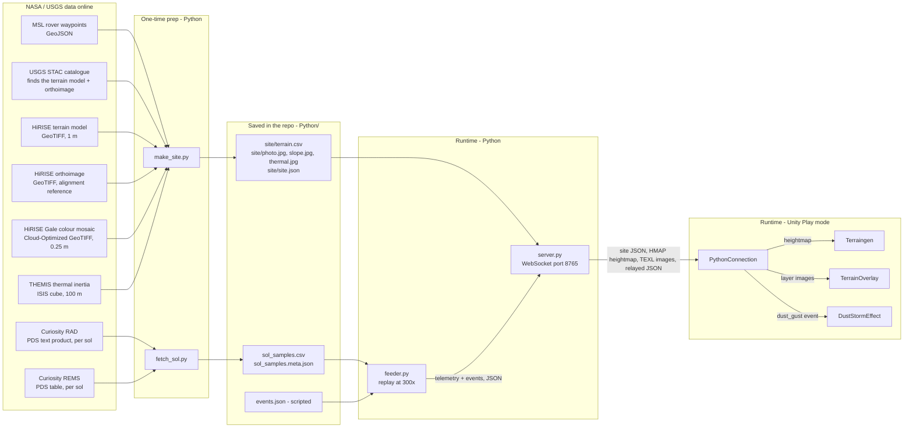
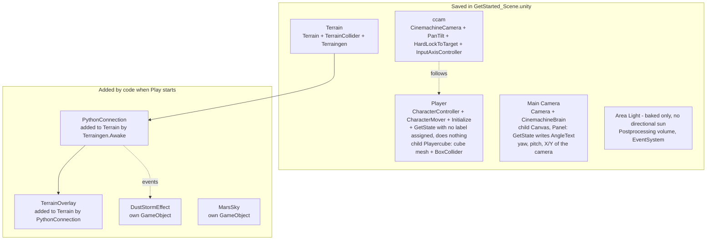
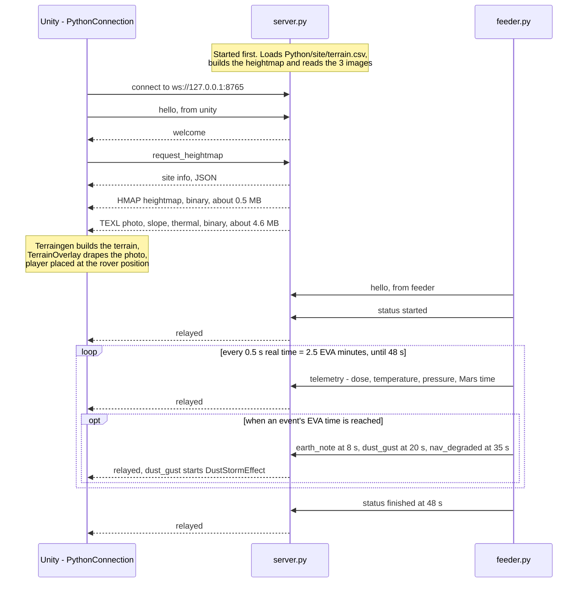
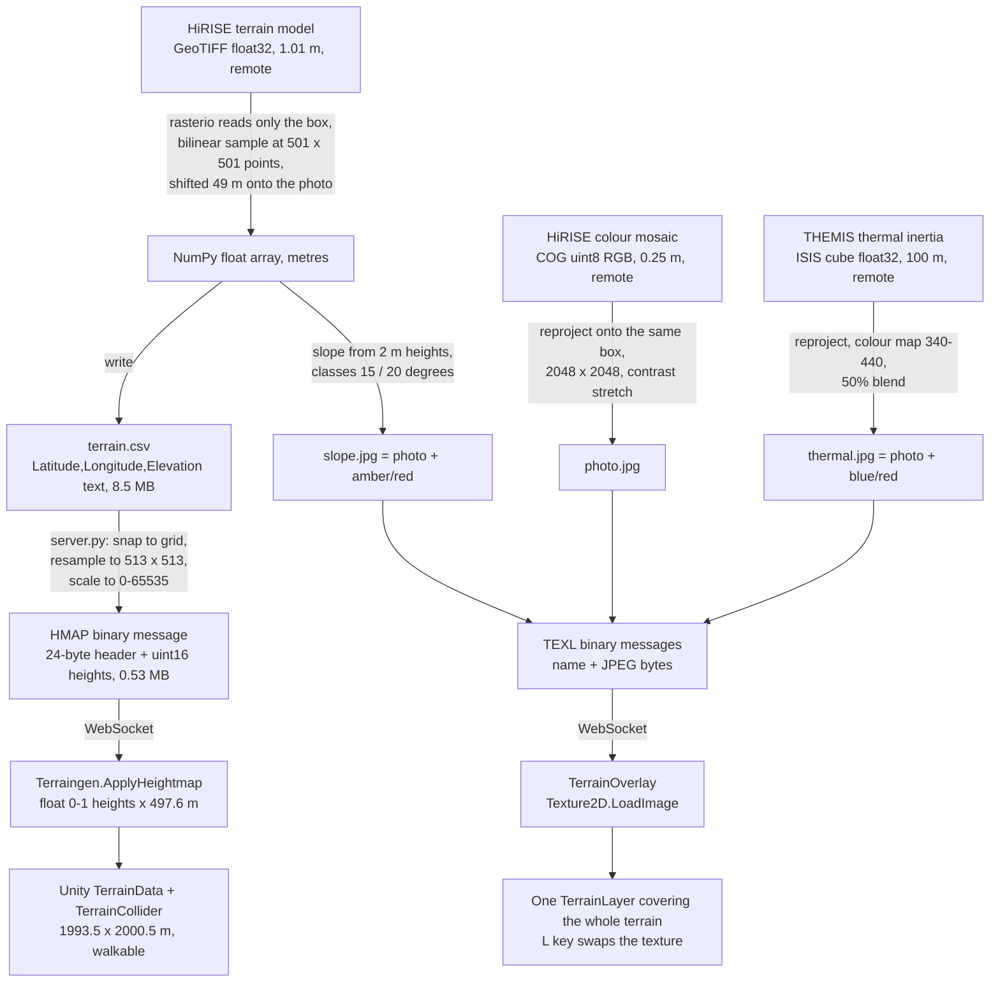
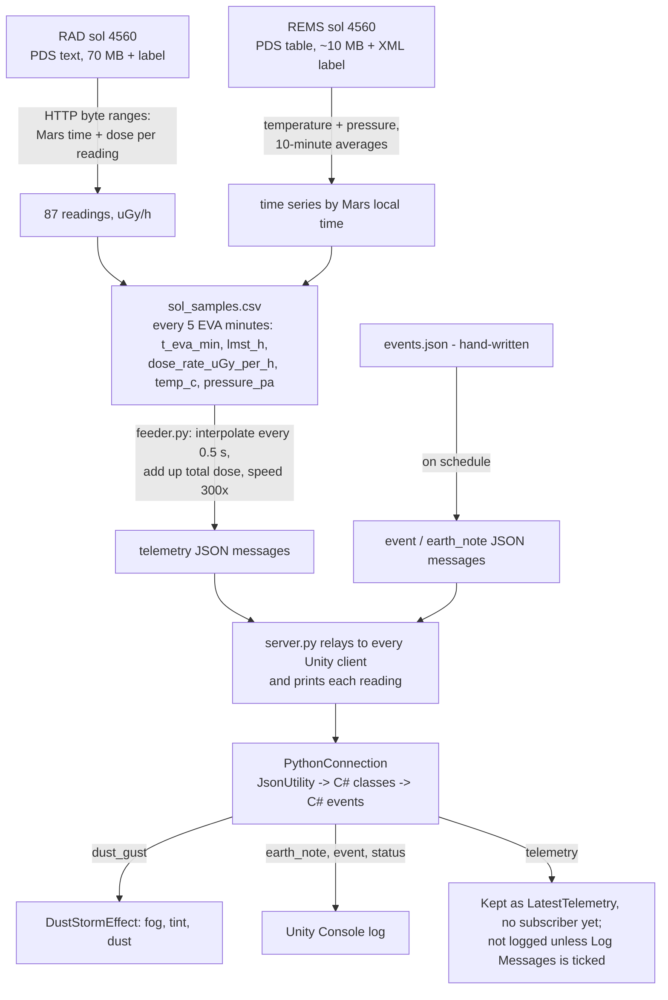

# Marsmap: Project Report

> **Living document.** This describes the project **as it is now**, not the final plan. It gets updated as features are added; see the [Changelog](#13-changelog) at the bottom.
>
> **State described:** branch `DataSetIntegration` at `89b8d8c` (14 Nov 2026), plus the VR work on branch `vr-quest` ([§14](#14-vr-meta-quest-in-progress)).
> **Not yet covered here:** features merged from `main` later on 14–15 Nov: the tiled Gale crater map (`dem_builder.py`, `server.py --polygon`, the new default), the compass and direction arrows (`Compass.cs`, `PointAt.cs`, new `GetState` nav panel), and the route-planning notebook (`Mars_mapping.ipynb`). These sections still need updating.
> **Event:** NASA Space Apps Challenge 2026, Seattle. Challenge: [Interplanetary Survival Guide: Martian Map](https://www.spaceappschallenge.org/2026/challenges/interplanetary-survival-guide-martian-map/).
> **Fact-checked** on 14 Nov 2026 against the code, the scene file, git and every linked source.

## Contents

1. [What the project is](#1-what-the-project-is)
2. [Tech stack](#2-tech-stack)
3. [Architecture](#3-architecture)
4. [How a demo run works, step by step](#4-how-a-demo-run-works-step-by-step)
5. [File tree: what each file does](#5-file-tree-what-each-file-does)
6. [Running the program and the demo](#6-running-the-program-and-the-demo)
7. [Data sources: where every piece of data comes from](#7-data-sources-where-every-piece-of-data-comes-from)
8. [How the data travels, and in what form](#8-how-the-data-travels-and-in-what-form)
9. [Messages between Python and Unity](#9-messages-between-python-and-unity)
10. [Map coordinates and alignment](#10-map-coordinates-and-alignment)
11. [Challenge requirements checklist](#11-challenge-requirements-checklist)
12. [Known limitations and open issues](#12-known-limitations-and-open-issues)
13. [Changelog](#13-changelog)
14. [VR (Meta Quest), in progress](#14-vr-meta-quest-in-progress)

---

## 1. What the project is

A first-person Unity demo of a **Marswalk**: an astronaut walking a 2 km × 2 km patch of **Mount Sharp in Gale Crater**, at the exact spot where NASA's Curiosity rover stood on **sol 4560 (4 June 2025)**. NASA dates a sol by the day most of it falls on. Sol 4560 began at about 22:30 UTC on 3 June, which is the date our data files currently store; see [§12](#12-known-limitations-and-open-issues).

- **The ground** is built from a real NASA HiRISE terrain model, with the real HiRISE colour photo draped over it.
- **Two data overlays** can be switched on: a slope-hazard map and a THEMIS thermal map.
- **Live conditions:**
  - Radiation and weather readings that Curiosity actually measured on that same sol are replayed in fast-forward.
  - Scripted mission events (an Earth message, a dust gust, a navigation failure) are played alongside.
  - The dust gust is shown on screen as a visual effect. The readings and the other events aren't on screen yet.

Python prepares the NASA data and serves it over a local WebSocket. Unity builds the world from what it receives.

---

## 2. Tech stack

| Layer | Technology | Version (as tested) | Used for |
|---|---|---|---|
| Game engine | Unity | 6000.6.9f1 (Unity 6.6) | The 3D world, player, camera, effects |
| Rendering | Universal Render Pipeline (URP) | 17.6.0 | Terrain shader (`Terrain/Lit`), fog, skybox |
| Input | Unity Input System | 1.20.1 (the project uses the new Input System only) | WASD / arrows / Space / Shift, L and G keys |
| Camera | Cinemachine | 6.6.0 | First-person pan/tilt camera locked to the player |
| Networking (Unity) | NativeWebSocket | 2.0.8 (`github.com/endel/NativeWebSocket#upm-2`) | WebSocket client in Unity |
| UI | uGUI + TextMeshPro | 2.6.0 | Teammate's Canvas readout; our overlay label and dust tint use IMGUI |
| Language (Unity) | C# | Unity's C# 9 | All Unity scripts |
| Language (data) | Python | 3.14 in `.venv` (3.10+ supported) | Data download, processing, server, replay |
| WebSocket server | `websockets` | 17.4 (requires ≥ 14) | `server.py`, `feeder.py` |
| Numerics | NumPy | 2.5.4 (requires ≥ 1.26) | Grids, resampling, slope |
| Geospatial | rasterio (GDAL), pyproj | 1.5.2, 3.8.0 | Reading GeoTIFF/ISIS map files over HTTPS, map projections |
| Images | Pillow | 13.0.0 | Writing the JPEG overlays |
| Version control | Git + Git LFS | LFS 3.8.1 | JPEG images are stored through LFS |
| Mapping tool (team) | JMARS (Arizona State University) | n/a | Scouting; manual CSV terrain exports |

Python packages are split in two files:
- **`requirements.txt`:** `numpy`, `websockets`. Enough for the server, feeder and `fetch_sol.py` (which uses only the standard library).
- **`requirements-maps.txt`:** adds `rasterio`, `pyproj` and `pillow`. Only `make_site.py`, `raster_to_csv.py` and `prep_terrain.py` need these.

---

## 3. Architecture

### 3.1 The big picture

There are three stages:
1. **One-time prep:** Python scripts download NASA data and save it as files in the repo.
2. **Runtime (Python):** a WebSocket server and a replay script read those files.
3. **Runtime (Unity):** Unity connects to the server and builds the world.

**Nothing is downloaded while the demo runs.**



The JMARS route still works side by side. A JMARS pixel-export CSV (`Latitude,Longitude,Elevation`) can be served directly with `server.py export.csv`. It gives terrain only, with no photo layers.

### 3.2 What's in the Unity scene

Most of the project's Unity logic is **created by code at runtime**, so it doesn't depend on scene edits. That avoids merge conflicts in the shared scene file.



**There is no sun in the scene.** The only light is the tutorial's "Area Light", which only affects pre-baked lighting. The runtime terrain is lit by ambient light alone, from `MarsSky`, so slopes look flatter than they should. The "sun" steps in `DustStormEffect` and `MarsSky` have nothing to change.

---

## 4. How a demo run works, step by step



In words:

1. **`server.py` starts.**
   1. It finds `Python/site/terrain.csv`.
   2. It snaps the points to a grid and resamples them to a 513 × 513 heightmap, scaled to 16-bit values.
   3. It reads `site.json` and the three JPEGs into memory.
2. **You press Play in Unity.**
   1. `Terraingen.Awake` makes a flat placeholder terrain and adds `PythonConnection`.
   2. `PythonConnection` connects, retrying every 2 s until the server answers.
   3. While `Terraingen` is still waiting for terrain, `PythonConnection` sends `request_heightmap`.
3. **The server replies with three kinds of message, in order:**
   1. **Site info:** name, sol, centre, and `vertical_exaggeration: 1`, which `PythonConnection` applies to `Terraingen`.
   2. **The heightmap:** `Terraingen.ApplyHeightmap` builds a 1,993.5 × 2,000.5 m terrain with 497.6 m of real relief, rebuilds the collider, centres the terrain on the world origin, and places the player at the centre.
   3. **Three images:** `TerrainOverlay` turns each into a texture and shows the photo first.
4. **If no heightmap arrives within 5 s,** `Terraingen` falls back to random Perlin hills. A server started after that still gets connected and the feeder data flows, but the real terrain is only requested again after restarting Play.
5. **`feeder.py` starts (after Play).**
   1. It replays `sol_samples.csv` at 300×: 4 EVA hours in 48 s.
   2. It sends the scripted events from `events.json` on schedule, between telemetry messages.
   3. The server relays everything to Unity, and `PythonConnection` turns each message into a C# event.
6. **What Unity does with the live data today:**
   - `dust_gust` triggers `DustStormEffect`.
   - `earth_note`, `event` and `status` messages are logged to the Unity Console.
   - **Telemetry (radiation and weather) isn't shown anywhere in Unity yet.** `PythonConnection` stores the latest reading (`LatestTelemetry`) and raises `TelemetryReceived`, but nothing subscribes. It isn't logged unless **Log Messages** is ticked on `PythonConnection`. The `server.py` terminal prints one line per reading. The on-screen HUD isn't built yet; see [§11](#11-challenge-requirements-checklist).
7. **`MarsSky`** replaces the blue tutorial sky with a Mars-coloured sky and warm ambient light when Play starts.

---

## 5. File tree: what each file does

Only project files are listed here. The Unity template's art, audio and tutorial folders are left out.

```text
Marsmap/
├── README.md                         Challenge text, our idea, resources list (team overview)
├── docs/
│   ├── PROJECT_REPORT.md             This report
│   └── VR_QUEST.md                   How to build and run on a Meta Quest (vr-quest branch)
├── .gitattributes                    Line-ending + LFS rules; *Terrain*.asset stored as binary, *.jpg via LFS
├── .gitignore                        Unity template + Python ignores (.venv/, __pycache__/, *.pyc); .DS_Store is not ignored
├── Packages/manifest.json            Unity packages (URP, Input System, Cinemachine, NativeWebSocket, ...)
├── Assets/
│   ├── Scenes/GetStarted_Scene.unity The one scene: Terrain, Player, cameras, Canvas, Area Light
│   ├── New Terrain.asset             Legacy TerrainData file; not used by the runtime terrain
│   └── SourceFiles/
│       ├── InputSystem/InputSystem_Actions.inputactions   Project input actions (Cinemachine look input)
│       └── Scripts/
│           ├── PythonConnection.cs   WebSocket client; routes terrain, images, telemetry, events
│           ├── Terraingen.cs         Builds the terrain at runtime (heightmap, Perlin fallback), places player
│           ├── TerrainOverlay.cs     Drapes photo / slope / thermal images on the terrain; L cycles; label
│           ├── CharacterMover.cs     WASD/arrows, Space jump, Shift sprint, Mars gravity (set in the scene)
│           ├── DustStormEffect.cs    Dust gust visuals on the dust_gust event; G = test gust
│           ├── MarsSky.cs            Mars sky gradient, warm ambient light
│           ├── OfflineReplay.cs      vr-quest: plays the bundled terrain + EVA replay with no server
│           ├── VR/                   vr-quest: MarsmapConfig, MarsmapInput (keys + Quest buttons), VRHud, VRRig
│           ├── Initialize.cs         Puts the player on the ground (fallback when no Terraingen)
│           ├── GetState.cs           Readout of yaw, pitch, X/Y; the working one is on the Canvas, tracking the camera
│           └── CameraFollow.cs, Pickup.cs, UpdateCollectibleCount.cs, MotionAudioController.cs
│                                     Leftovers from the Unity tutorial template; not used in the scene
└── Python/
    ├── README.md                     How to run the Python side; data source table; demo timeline
    ├── requirements.txt              numpy, websockets (server, feeder, fetch_sol)
    ├── requirements-maps.txt         + rasterio, pyproj, pillow (map scripts)
    ├── server.py                     WebSocket server: sends terrain + images, relays feeder data
    ├── feeder.py                     Replays sol_samples.csv + events.json at 300x
    ├── fetch_sol.py                  Downloads one sol of RAD + REMS -> sol_samples.csv
    ├── make_site.py                  Downloads HiRISE + THEMIS for the rover's position -> site/
    ├── prep_terrain.py               Earlier HiRISE -> Unity RAW heightmap + cost grid tool; helpers reused
    ├── raster_to_csv.py              Any map file -> CSV grid (values, or slope classes)
    ├── export_offline.py             vr-quest: writes the offline bundle to Assets/StreamingAssets/Marsmap/
    ├── events.json                   Scripted demo events (hand-written)
    ├── sol_samples.csv               REAL replay data: sol 4560, 09:00-13:00 Mars time, every 5 EVA min (49 rows)
    ├── sol_samples.meta.json         Exact NASA files sol_samples.csv came from
    └── site/
        ├── terrain.csv               REAL heights: 501 x 501 points, 4 m apart (Latitude,Longitude,Elevation)
        ├── photo.jpg                 REAL HiRISE colour photo of the same box, 2048 px (~1 m/px)
        ├── slope.jpg                 Photo + slope hazard colours computed from the HiRISE heights
        ├── thermal.jpg               Photo + THEMIS thermal inertia colours
        └── site.json                 Site name, sol, centre, box, layer labels/credits, source URLs, alignment shift
```

### 5.1 Unity scripts in more detail

| Script | Written by | What it does | Key details |
|---|---|---|---|
| `PythonConnection.cs` | Merged, ours + teammate | WebSocket link to `server.py` | Reconnects every 2 s. Routes `HMAP` to `Terraingen` and `TEXL` to `TerrainOverlay`; turns JSON into C# events (`TelemetryReceived`, `EventReceived`, `EarthNoteReceived`, `StatusReceived`, `SiteReceived`). Logs events and status, not telemetry. Asks for terrain only while `Terraingen.WaitingForHeightmap`. Catches handler errors so one bad message can't stop the stream. |
| `Terraingen.cs` | Teammate (small edits by us) | Builds `TerrainData` at runtime | Placeholder in `Awake`. Heightmap from Python, or Perlin fallback after 5 s. Colours by height (matte), recentres the terrain at the world origin, places the player, aims the Cinemachine camera. Default vertical exaggeration 5×; the HiRISE site sets 1×. |
| `TerrainOverlay.cs` | Ours | Shows site images on the terrain | One `TerrainLayer` the size of the terrain (`tileSize` = terrain size), so the image covers it exactly once. **L** cycles photo → slope → thermal → height colours. IMGUI label bottom-left. |
| `CharacterMover.cs` | Teammate (edits by us) | Player movement | Adds default WASD/arrow and Space bindings if none are set in the Inspector. Walking 5 m/s, Shift = 3× sprint. Gravity −3.72 m/s² (Mars) is set on the Player in the scene; the script's own default is −7.42, so a newly added `CharacterMover` needs it set again. Movement direction follows the Cinemachine pan angle. Slopes don't slow or block movement. |
| `DustStormEffect.cs` | Ours | Dust gust visuals | On `dust_gust`: orange exponential-squared fog (peak density 0.012), 22% screen tint, wind-blown dust particles around the camera. Fades in 3 s, holds, fades out 4 s; restores the scene settings afterwards. It would also dim and warm a directional sun, but the scene has none. **G** = test. |
| `MarsSky.cs` | Ours | Mars sky look | Builds a sky gradient texture on the built-in `Skybox/Panoramic` shader, sets warm trilight ambient and reduces sky reflections. It would also warm a directional sun, but the scene has none, so the warm look comes from the sky and ambient light alone. Restored when Play stops. |
| `GetState.cs` | Teammate | On-screen readout | Yaw, pitch and X/Y on a TextMeshPro label. The copy on Main Camera > Canvas > Panel works (it tracks the camera); the copy on the Player has no label assigned and does nothing. |
| `Initialize.cs` | Teammate | Ground placement | Puts the player on the terrain surface; does nothing when `Terraingen` handles it. |

### 5.2 Python scripts in more detail

| Script | When you run it | Input | Output |
|---|---|---|---|
| `make_site.py` | Once per site (~20 s) | NASA rover waypoints; USGS STAC catalogue; HiRISE terrain model, orthoimage and colour mosaic, and THEMIS mosaic, all read remotely, box only | `Python/site/` (CSV + 3 JPEGs + `site.json`) |
| `fetch_sol.py` | Once per sol (~1 min) | RAD and REMS files for one sol from the NASA Planetary Data System (PDS) | `sol_samples.csv` + `sol_samples.meta.json` |
| `server.py` | Every demo (terminal 1) | `site/` or a JMARS CSV | WebSocket on port 8765 |
| `feeder.py` | Every demo (terminal 2, after Play) | `sol_samples.csv`, `events.json` | Live JSON messages, 48 s |
| `raster_to_csv.py` | Optional | Any GeoTIFF / ISIS map file | CSV grid of values or slope classes |
| `prep_terrain.py` | Optional, older tool | HiRISE terrain model + photo | Unity RAW heightmap, cost grid, `meta.json`; also provides helpers that `make_site.py` uses |

---

## 6. Running the program and the demo

### 6.1 One-time setup

```bash
# from the Marsmap folder
python3 -m venv .venv
.venv/bin/pip install -r Python/requirements.txt
.venv/bin/pip install -r Python/requirements-maps.txt   # only to regenerate map data
# Windows: .venv\Scripts\pip install -r Python\requirements.txt
```

Unity: open the project in **Unity 6000.6.9f1** and open `Assets/Scenes/GetStarted_Scene.unity`. The NativeWebSocket package installs itself from GitHub. Git LFS must be installed to get the JPEGs: GitHub Desktop includes it; on the command line run `git lfs install`.

The site and sol data are already generated and committed. You only need these two commands to change location or sol:

```bash
.venv/bin/python Python/make_site.py --sol 4560            # map data for where the rover was on that sol
python3 Python/fetch_sol.py --sol 4560 --start-lmst 9:00   # radiation + weather for that sol
```

### 6.2 Running the demo

```bash
python3 Python/server.py      # terminal 1, wait for "Server listening"
# press Play in Unity
python3 Python/feeder.py      # terminal 2, while Unity is in Play mode
```

`server.py` and `feeder.py` relaunch themselves inside `.venv`, so plain `python3` works.

### 6.3 Controls

| Key | Action |
|---|---|
| W A S D / arrow keys | Walk (5 m/s) |
| Mouse | Look |
| Space | Jump (in Mars gravity) |
| Hold Left Shift | Move 3× faster (the site is 2 km across) |
| L | Next map layer: photo → slope hazard → thermal → height colours |
| G | Test dust gust (no feeder needed) |

Click inside the Game view first so it has keyboard focus.

### 6.4 Demo timeline (default speed, 300×)

| Real time after starting `feeder.py` | Event | What you see |
|---|---|---|
| 0 s | EVA started | Console |
| ~8 s | Earth note: "Science team: image the vein at Stop 2 before sampling." | Console |
| ~20 s | Dust gust, 13 s | Fog rolls in, orange tint, blowing dust; clears by ~33 s |
| ~35 s | Navigation degraded | Console |
| ~48 s | EVA finished | Console |

Change event times in `Python/events.json` (`t_eva_min`, where 1 EVA minute = 0.2 s at 300×) or the speed with `--speed`.

### 6.5 Troubleshooting

| Symptom | Cause | Fix |
|---|---|---|
| Rolling smooth hills, no photo, L does nothing | No heightmap arrived within 5 s: Console says "Can't reach…", then "Perlin fallback" | Start `server.py` **before** pressing Play, or restart Play after starting it |
| `address already in use` when starting the server | Another server is already on port 8765 | Stop it (`lsof -nP -iTCP:8765`), or use `--port` |
| No dust and no events | `feeder.py` wasn't running during Play | Start it after pressing Play |
| Keys do nothing | The Game view doesn't have focus | Click inside the Game view |
| Fake sine-wave hills 20 km wide | Server started with `--demo` | Run it without `--demo` |
| No radiation/weather numbers anywhere in Unity | Not built yet | Watch the `server.py` terminal, or tick **Log Messages** on `PythonConnection` in Play mode |

---

## 7. Data sources: where every piece of data comes from

### 7.1 Summary: what's real

| What you see / receive | Real? | Source |
|---|---|---|
| Starting point / map centre | ✅ Real | Curiosity's position on sol 4560 (NASA/JPL waypoints) |
| Ground shape | ✅ Real | HiRISE terrain model `DTEEC_019698_1750_019988_1750_U01` |
| Photo layer | ✅ Real (colour-enhanced) | HiRISE colour version of the MSL Gale orthophoto mosaic |
| Slope hazard layer | ✅ Computed from real heights | HiRISE terrain model; 15°/20° limits borrowed from Artemis lunar EVA planning |
| Thermal layer | ✅ Real | Mars Odyssey THEMIS thermal inertia |
| Radiation dose | ✅ Real, time-compressed | Curiosity RAD, sol 4560 |
| Temperature, pressure, Mars time | ✅ Real, time-compressed | Curiosity REMS, sol 4560 |
| Gravity | ✅ Real constant | 3.72 m/s² |
| Earth note, dust gust, nav failure | ❌ Scripted | `Python/events.json` |
| Dust visuals, sky colour | ❌ Artistic | `DustStormEffect.cs`, `MarsSky.cs` |
| Wind | Not available | REMS wind sensor has returned no data for years |
| Perlin hills / demo sine hills | ❌ Fake fallbacks | Only when no heightmap arrives or the server runs with `--demo` |

### 7.2 Each source in detail

#### Curiosity rover position: NASA/JPL MSL waypoints
- **Link:** <https://mars.nasa.gov/mmgis-maps/MSL/Layers/json/MSL_waypoints.json>
- **Background:** JPL's MMGIS mapping system publishes Curiosity's position after every drive. It's the data behind NASA's "Where is Curiosity?" map. The file is GeoJSON with one feature per waypoint (sol, latitude, longitude, elevation, drive distance).
- **Used:** sol 4560 → **latitude −4.79984723°, longitude 137.3835414° E**. `make_site.py` centres the 2 km box there, so you start where the rover was on the same sol as the replayed weather and radiation.

#### Terrain heights: HiRISE digital terrain model (DTM)
- **Link (file used):** <https://astrogeo-ard.s3-us-west-2.amazonaws.com/mars/mro/hirise/controlled/dtm/ESP_019698_1750_ESP_019988_1750/DTEEC_019698_1750_019988_1750_U01.tif>
- **Catalogue:** USGS Astrogeology STAC catalogue of HiRISE terrain models; `make_site.py` uses it to find the terrain model and its orthoimages. [Browser](https://stac.astrogeology.usgs.gov/browser-dev/#/api/collections/mro_hirise_socet_dtms) · [API](https://stac.astrogeology.usgs.gov/api/collections/mro_hirise_socet_dtms) · [docs](https://stac.astrogeology.usgs.gov/docs/data/mars/hirise_dtms/)
- **Background:**
  - **The camera:** HiRISE (High Resolution Imaging Science Experiment) is the camera on NASA's Mars Reconnaissance Orbiter, operated by the University of Arizona.
  - **How heights are measured:** terrain models are computed from **stereo pairs**, two images of the same ground taken from different angles. This one comes from images `ESP_019698_1750` and `ESP_019988_1750`.
  - **Format:** USGS distributes them as analysis-ready, cloud-optimized GeoTIFFs: float32 elevations in metres, ~1.01 m pixels, in an equirectangular map projection on a 3,396.19 km Mars sphere.
- **Used:** the 2 km box only, read over HTTPS without downloading the whole file. Elevation −3,875.6 to −3,377.9 m, so 497.7 m of relief in the box, no missing data. That's 497.6 m after `server.py` resamples it to the 513 × 513 heightmap, which is the figure Unity uses. Also the source for the slope layer.

#### Photo layer: colour MSL Gale orthophoto mosaic (HiRISE)
- **Link (file used):** <https://asc-pds-services.s3.us-west-2.amazonaws.com/mosaic/Mars/MSL/MSL_Gale_HiRISE-LRGB_78quads_sharp_cog.tif>
- **Product page:** <https://astrogeology.usgs.gov/search/map/mars_msl_gale_merged_orthophoto_mosaic_25cm>
- **Background:**
  - **What it is:** the colour version, added July 2025, of the *MSL Gale Merged Orthophoto Mosaic*. That mosaic is the 25 cm/pixel base map for the Curiosity mission's science and engineering operations, and the rover's positions are mapped in the same frame.
  - **Who made it:** Timothy Parker and Fred J. Calef III. The originators are JPL-Caltech, NASA, USGS Astrogeology and the University of Arizona; USGS Astrogeology publishes it.
  - **How it was made:** HiRISE colour strips (78 quads) were georectified with manually placed tie-points and fused onto the mission's grey-scale HiRISE RED orthophoto mosaic. The result was lightly sharpened and saved as a JPEG-compressed Cloud-Optimized GeoTIFF.
  - **Colour:** the product page makes no natural-colour claim, so treat the colour as enhanced, not as what an eye would see.
  - **Coverage and download:** the colour file covers about 9 × 19 km of Curiosity's Mount Sharp traverse. The product page's main download is the older grey-scale version; the colour file is described in its "NEW (July 2025)" note.
- **Used:** cropped to the box, reduced to 2048 × 2048 px (~0.98 m/pixel), contrast-stretched, saved as `photo.jpg`. Also the base of the slope and thermal images.

#### Alignment reference: HiRISE orthoimage
- **Link:** <https://astrogeo-ard.s3-us-west-2.amazonaws.com/mars/mro/hirise/controlled/dtm/ESP_019698_1750_ESP_019988_1750/ESP_019988_1750_RED_C_01_ORTHO.tif>
- **Why:** the terrain model and the Gale mosaic sit on slightly different base maps, about 49 m apart here. `make_site.py` compares this orthoimage (which matches the terrain model's grid) with the mosaic and moves the terrain onto the mosaic: 34.18 m west and 34.79 m north, match correlation 0.73. See [§10](#10-map-coordinates-and-alignment).

#### Thermal layer: Mars Odyssey THEMIS thermal inertia
- **Link (file used):** <https://asc-astropedia.s3.us-west-2.amazonaws.com/Mars/Odyssey/THEMIS-Global-Thermal-Inertia-Mosaic/Quantitative-32-Bit/THEMIS_TI_Mosaic_Quant_30S120E_100mpp.cub>
- **Product page:** <https://astrogeology.usgs.gov/search/map/themis_thermal_inertia_mosaic_quantitative_30s120e_100mpp>. The tile covers latitude −30 to 0 and longitude 120–180° E, which includes Gale.
- **Background:**
  - **The instrument:** THEMIS (Thermal Emission Imaging System) on NASA's 2001 Mars Odyssey orbiter, operated by Arizona State University.
  - **What it measures:** **thermal inertia** is how strongly the ground resists changing temperature between day and night, in J m⁻² K⁻¹ s⁻½. Loose dust and fine sand change temperature quickly (low values); rock and hard ground change slowly (high values). That makes it a proxy for "sandy vs. rocky".
  - **Format:** an ISIS3 cube of float32 values at 100 m per pixel.
- **Used:** about 20 × 20 THEMIS pixels cover the box, with values 320–450. They're colour-mapped from blue (340) to red (440) and blended 50% over the photo as `thermal.jpg`. The scale is relative to this box.

#### Radiation: Curiosity RAD (Radiation Assessment Detector)
- **Archive:** <https://pds-ppi.igpp.ucla.edu/data/MSL-M-RAD-3-RDR-V1.0/> (NASA Planetary Data System, Planetary Plasma Interactions node, UCLA)
- **Files used, sol 4560:**
  - Label: <https://pds-ppi.igpp.ucla.edu/data/MSL-M-RAD-3-RDR-V1.0/DATA/SOL_04489_04612/RAD_RDR_2025_154_22_44_4560_V00.LBL>
  - Data: <https://pds-ppi.igpp.ucla.edu/data/MSL-M-RAD-3-RDR-V1.0/DATA/SOL_04489_04612/RAD_RDR_2025_154_22_44_4560_V00.TXT>
- **Background:**
  - **The instrument:** RAD was built by Southwest Research Institute together with Christian-Albrechts-Universität zu Kiel (Germany). It measures the energetic-particle radiation reaching Mars's surface (galactic cosmic rays, solar particles, secondary neutrons). That's the radiation an astronaut would absorb.
  - **The data:** each sol's calibrated data is one ~70 MB text file, split into observation periods of about 16 minutes. Each period is stored as a pair of blocks:
    - the first holds the Mars local time and a **total dose rate** in µGy/h from two detectors, **B** (silicon) and **E** (plastic, closer to human tissue);
    - the second holds only a pulse-height table.
- **Used:**
  - **Detector E.** The file has 87 dose readings across the whole sol (4.27–6.85 µGy/h). 15 of them fall in the 09:00–13:00 EVA window (5.96–6.39 µGy/h), and `sol_samples.csv` interpolates between them every 5 EVA minutes (5.96–6.38 µGy/h).
  - **Partial download:** `fetch_sol.py` reads the label to find each reading's byte position and downloads only those bytes.
  - **Total dose:** the feeder adds up the total dose over the EVA: about 0.025 mGy (it reports 0.0246 mGy) for the 4-hour EVA.

#### Weather: Curiosity REMS (Rover Environmental Monitoring Station)
- **Archive:** <https://atmos.nmsu.edu/PDS/data/mslrem_1001/> (NASA Planetary Data System, Atmospheres node, New Mexico State University)
- **File used, sol 4560:** <https://atmos.nmsu.edu/PDS/data/mslrem_1001/DATA/SOL_04489_04612/SOL04560/RME_802257765RMD45600000000_______P1.TAB>
- **Background:**
  - **The instrument:** REMS, provided by Spain's Centro de Astrobiología, measures air and ground temperature, pressure, humidity and UV.
  - **Wind:** its wind sensor has returned no data for these sols.
  - **Product:** the `RMD` product is the processed version: a comma-separated table of about 27,700 timestamped samples per sol, with columns described in a PDS4 XML label.
- **Used:** `AMBIENT_TEMP` (kelvin → °C) and `PRESSURE` (Pa) by Mars local time, averaged into 10-minute bins. Over the EVA window (09:00–13:00 Mars local time): **−56 °C warming to −41 °C**, and **797 to 767 Pa**.
- **Also available but not used:** NASA's REMS weather feed, <https://mars.nasa.gov/rss/api/?feed=weather&category=msl&feedtype=json>. It gives one summary per sol (minimum and maximum air and ground temperature, one pressure value, UV index, sunrise and sunset) rather than a time series. It is more up to date than the PDS archive and currently reaches sol 4995 (25 Aug 2026).

#### Scripted events: `Python/events.json` (not real data)
Hand-written for the demo: an Earth message, a dust gust and a navigation failure. Each has an EVA time; the gust also has a duration.

#### JMARS (team tool)
- **Link:** <https://jmars.asu.edu/>
- **Background:** JMARS is Arizona State University's Mars GIS tool.
- **How the team uses it:** scouting, and manual CSV exports (`Latitude,Longitude,Elevation`) that `server.py` can serve as terrain. No JMARS export is committed yet.
- **Finding the site in JMARS:** centre −4.79985°, 137.38354° E; box latitude −4.81672 to −4.78298, longitude 137.36667 to 137.40041 E.

---

## 8. How the data travels, and in what form

### 8.1 Map data (terrain + images)



| Stage | Form | Where |
|---|---|---|
| Online source | GeoTIFF / COG / ISIS cube, read in place over HTTPS | NASA/USGS servers |
| Prep | NumPy arrays in the terrain model's map projection | `make_site.py` |
| Saved | CSV (heights), JPEG (images), JSON (metadata) | `Python/site/` |
| Served | Binary `HMAP` + binary `TEXL` + JSON `site` WebSocket frames | `server.py` |
| In Unity | `float[,]` heights → `TerrainData`; JPEG → `Texture2D` → `TerrainLayer` | `Terraingen`, `TerrainOverlay` |

### 8.2 Live data (radiation, weather, events)



| Stage | Form | Where |
|---|---|---|
| Online source | PDS3 text product (RAD), PDS4 table (REMS) | NASA PDS archives |
| Saved | `sol_samples.csv`: 49 rows, one every 5 EVA minutes; `.meta.json` lists the exact source files | `Python/` |
| Replayed | JSON text messages, about 2 per second | `feeder.py` → `server.py` |
| In Unity | `TelemetryMessage`, `EvaEventMessage`, `EarthNoteMessage`, `StatusMessage` C# objects, via C# events | `PythonConnection` |

---

## 9. Messages between Python and Unity

All messages go through one WebSocket server on port 8765. Unity connects to `ws://127.0.0.1:8765` and `feeder.py` to `ws://localhost:8765`, each with its own connection, and the server relays between them. JSON messages carry `"v": 1` (schema version) and `"type"`, except Unity's `request_heightmap`, which has only `"type"`.

| Type | Direction | Format | Content |
|---|---|---|---|
| `hello` | Unity → server, feeder → server | JSON | `{"from": "unity"}` or `{"from": "feeder"}`. A feeder becomes a data source; everyone else is a viewer |
| `welcome` | server → client | JSON | Confirms the role |
| `request_heightmap` | Unity → server | JSON | Sent only while `Terraingen` is still waiting for terrain |
| `site` | server → Unity | JSON | `name, sol, earth_date, center_lat, center_lon, size_m, vertical_exaggeration, layers[{name,label,credit}]` |
| `HMAP` | server → Unity | Binary | `"HMAP"`, int32 resolution N, float32 min elevation, max elevation, size X (m), size Z (m), then N×N uint16 (row 0 = south, column 0 = west) |
| `TEXL` | server → Unity | Binary | `"TEXL"`, int32 name length L, L bytes name (`photo` / `slope` / `thermal`), then the JPEG file bytes |
| `status` | feeder → Unity | JSON | `state: started` (with `speed`) / `finished` (with `dose_total_mGy`) |
| `telemetry` | feeder → Unity | JSON | `t_eva_s, lmst_h, dose_rate_uGy_h, dose_total_mGy, temp_c, pressure_pa, source` |
| `event` | feeder → Unity | JSON | `t_eva_s, id (dust_gust / nav_degraded), severity, text`, optional `duration_s` |
| `earth_note` | feeder → Unity | JSON | `t_eva_s, text, delay_s` (Mars–Earth one-way light delay, 840 s in the script) |

A Unity client that connects late is immediately sent the last `status` and `telemetry`.

---

## 10. Map coordinates and alignment

```text
                 North (image top row, terrain-local z = 2000.5 m)
        NW (-4.782977, 137.366671)        NE (-4.782977, 137.400412)
          +----------------------------------------+
          |                                        |
          |                                        |
  West    |              * Curiosity, sol 4560     |    East
 (local   |         (-4.799847, 137.383541)        | (local
  x = 0)  |      = terrain centre = spawn point    |  x = 1993.5 m)
          |                                        |
          +----------------------------------------+
        SW (-4.816718, 137.366671)        SE (-4.816718, 137.400412)
                 South (heightmap row 0, terrain-local z = 0)
```

- **Box:**
  - **On the ground:** about 1,993 m east–west × 2,000 m north–south. The map projection stretches east–west distances slightly at this latitude.
  - **In Unity:** 1,993.5 × 2,000.5 m, because `server.py` converts degrees with a rounded 59.29 km per degree, a 0.03% difference.
  - The heights and images use the same box, so they still line up.
- **Coordinates:** planetocentric latitude, **east** longitude (0–360°), the JMARS default.
- **Orientation:** nothing is ever flipped.
  - **Heightmap:** row 0 = south, column 0 = west.
  - **Images:** top row = north, left column = west.
  - **Unity:** x = east, z = north. `Texture2D.LoadImage` puts the image's top row at the north edge.
- **Terrain-local vs. world coordinates:** the x/z values in the diagram are terrain-local, which is what `TerrainData` and the images use. In Play mode `Terraingen` recentres the terrain (`recenterTerrainAtOrigin`, on by default):
  - **World extent:** world x runs from about −996.8 m (west edge) to +996.8 m (east), and world z from about −1,000.3 m (south) to +1,000.3 m (north).
  - **Rover / spawn point:** world (0, ≈0, 0), with the ground there at y ≈ 0.
  - **Who sees world values:** the player, the `GetState` readout and any HUD, minimap or route code.
  - **To convert:** world x = local x − 996.75, and world z = local z − 1,000.26.
- **Alignment accuracy:** the terrain is shifted ~49 m to match the photo. The photo is also rotated ~0.3° relative to the terrain model, and a shift alone can't correct that. The match is within ~1 m at the centre (where you start) and up to ~10 m off at the corners.
- **Resolution in Unity:** heights ~3.9 m per heightmap cell (513 × 513); images ~0.98 m per pixel.

---

## 11. Challenge requirements checklist

Key: ✅ done · 🟡 partly done · ⬜ not started

### 11.1 NASA's suggestions (from the challenge page)

| Suggestion | Status | Evidence / what's missing |
|---|---|---|
| **Use NASA data** to build a map, tool or interface for a Marswalk | ✅ | Everything is NASA mission data (MRO HiRISE, Mars Odyssey THEMIS, Curiosity RAD/REMS/waypoints), hosted by NASA/JPL (mars.nasa.gov), the NASA PDS and USGS |
| **Start from a science goal**; pick a location that serves it (example: boxwork on Mount Sharp) | 🟡 | The site is Curiosity's real sol-4560 position on Mount Sharp, in the boxwork-era sol range. **Not yet verified** that the 2 km box contains the boxwork ridges. No science stops or tasks yet |
| **Layer at least three kinds of data** (optical, thermal, spectral, topographic, geophysical, atmospheric, radiation, chemical) | ✅ | **Five in the data:** optical (HiRISE photo), topographic (HiRISE heights + slope), thermal (THEMIS), radiation (RAD), atmospheric (REMS). Three are on the terrain; radiation and atmospheric data reach Unity but aren't shown yet |
| **Astronaut safety: radiation environment** | 🟡 | Real dose rate and accumulated EVA dose are computed and sent to Unity. **Not displayed or logged in Unity yet** (visible in the `server.py` terminal) |
| **Astronaut safety: suits / equipment limit mobility** | 🟡 | Slope hazard layer marks caution (15–20°) and no-go (≥ 20°). A tighter "carrying gear" limit (15°, `LOADED_NOGO_DEG` in `prep_terrain.py`) is defined but not used. Movement isn't suit-limited: 5 m/s walking (15 m/s with Shift), and slopes don't slow or block the player; only gravity (3.72 m/s²) is Mars-real |
| **Include a route that avoids major obstacles** | 🟡 | Not on this branch. A teammate's Colab notebook on the unmerged `python_route` branch (`Python/Mars_mapping.ipynb`) plans multi-leg A* routes with slope limits (18° forward, 25° sideways) on a 1 m Gale terrain model near Bradbury Landing, and exports a heightmap and waypoint CSV for Unity. It covers a different area from our sol-4560 box and isn't connected to Unity yet. `prep_terrain.py` can also make a route-cost grid. No route is shown in Unity |
| **Pick a format** (habitat display, tablet, helmet HUD, …) | 🟡 | Chosen: **helmet HUD, first person**. Existing on-screen elements: layer label and credit, dust effect, yaw/pitch readout. Teammate's HUD panels (compass, rover photos, minimap) exist only in an unsaved local scene, not committed |
| **Look beyond Mars** (how the Moon was mapped) | 🟡 | Slope limits are borrowed from **Artemis** lunar EVA planning (stated in the app). The README's Apollo/Artemis HUD lessons (home arrow first) aren't implemented yet |
| **Show what to expect with point-of-view imagery** from surface missions | ⬜ | Not built. Curiosity raw images for the same sols are the planned source (<https://mars.nasa.gov/msl/multimedia/raw-images/>) |

### 11.2 Our own plan (from the root README)

| Planned feature | Status | Notes |
|---|---|---|
| Science goal: boxwork ridges on Mount Sharp | 🟡 | Location set by the rover's position; boxwork coverage not yet confirmed |
| Layered map: imagery, elevation/slope, thermal, radiation, weather over ~2 km | 🟡 | Imagery, slope and thermal are on the terrain (L key). Radiation and weather reach Unity in the data stream but aren't in the view yet |
| Safe route around steep slopes, linking science stops | 🟡 | Prototype A* planner in `python_route` (`Mars_mapping.ipynb`), different area, not merged |
| Science stops with a task and a Curiosity photo | ⬜ | |
| HUD: home arrow, next-target arrow, hazard warnings, time remaining | ⬜ | Hazards are visible on the slope layer only |
| Simulated live conditions: replayed real radiation/weather + scripted events | 🟡 | Data and events flow, and the dust gust is visible. Readouts and event banners aren't on screen |
| Data preparation scripts | 🟡 | Terrain, imagery, slope/hazard, thermal and sol data: `make_site.py`, `fetch_sol.py`, `raster_to_csv.py`, `prep_terrain.py`. Science-stop preparation not started |
| Live telemetry service (WebSocket) | ✅ | `server.py` + `feeder.py` |
| Unity first-person demo on real Mars terrain | ✅ | |
| Top-down hazard minimap | ⬜ | Teammate's placeholder panel only, not committed |

### 11.3 Space Apps housekeeping

| Item | Status |
|---|---|
| Data sources credited | ✅ `site.json`, `Python/README.md`, this report, on-screen layer credits |
| Open-source licence (Space Apps requires one) | ⬜ No `LICENSE` file yet |
| Project demo for submission: a video of 30 s or less, or 7 slides or fewer, at a public link ([submission guide](https://www.spaceappschallenge.org/resources/project-submission-guide/); check the 2026 version) | ⬜ Not made yet. The in-engine timeline runs 48 s at the default speed, so a 30 s video needs a higher `--speed` or cuts |
| Live demo pacing for the local 2-minute pitch | ✅ Demo events fit in 48 s (default `feeder.py` speed) |

---

## 12. Known limitations and open issues

**Not built yet**
- **On-screen data:** HUD readouts (dose, temperature, pressure, EVA clock, Mars time) and banners for the Earth note and nav warning.
  - The Earth note and nav warning appear only in the Unity Console.
  - The telemetry values aren't shown in Unity at all: only in the `server.py` terminal, or in the Console if `PythonConnection`'s **Log Messages** is ticked.
- **Navigation and science:** route display (see `python_route`), science stops, home and next-target arrows, rover POV photos, minimap.

**Lighting**
- **No sun:** the scene's only light is a baked Area Light, so the terrain is lit by ambient light only and slopes look flat. The sun-dimming step of the dust gust and the sun-warming step of `MarsSky` have nothing to act on. Adding a directional light would fix all three.

**Data accuracy**
- **Photo vs. terrain:** within ~1 m at the centre, up to ~10 m off at the corners (0.3° rotation not corrected).
- **Thermal layer:** coarse (100 m pixels) and colour-scaled relative to this box only.
- **Photo colour:** enhanced, not exact natural colour.
- **Time:** compressed 300×. The values are real; the speed isn't.
  - The feeder treats the 240 EVA minutes as Earth minutes, but the CSV spans 4 Mars hours (about 4.11 Earth hours).
  - The physically exact dose for 09:00–13:00 Mars time would be about 0.0253 mGy, against the 0.0246 reported.
- **Wind:** not available from REMS.
- **Sol date stored as 3 June 2025:** `site.json` and `sol_samples.meta.json` store the date the sol *began* (from the RAD file's start time), which also appears in the data credit sent to Unity. NASA lists sol 4560 as **4 June 2025**.

**Unity / build**
- **Standalone builds:** URP may strip fog and the panoramic sky shader. The dust tint and particles still work, and `MarsSky` falls back to a solid sky colour.
- **`Terraingen` default exaggeration:** 5× (meant for large JMARS areas). The HiRISE site overrides it to 1×. A JMARS CSV without `site.json` still uses 5×.
- **Late server:** if the heightmap doesn't arrive within 5 s, Play has to be restarted to get the real terrain.
- **Unused files:** template leftovers (`CameraFollow`, `Pickup`, `UpdateCollectibleCount`, `MotionAudioController`) are in the scripts folder; `New Terrain.asset` is no longer used by the runtime terrain; the Player's `GetState` has no label.
- **Warnings:** Unity 6 CS0618 "obsolete" warnings for `FindFirstObjectByType` in `Terraingen.cs` (2 places) and `Initialize.cs`. Harmless; `FindAnyObjectByType` removes them.

**Repository / team**
- **Teammate work not merged into `DataSetIntegration`:**
  - **`main` @ `4abc9fa` "Tweaks!":** scene changes and extra terrain assets.
  - **`fuckunity` @ `a9309a2` "Movement working!":**
    - `CharacterMover` changes
    - an empty `SimpleMover.cs` stub
    - a generated `InputSystem_Actions.cs` (wrapper-code generation switched on in the `.inputactions.meta`)
    - player spawn height +0.1 → +0.5 m in `Terraingen.cs`
    - scene changes
  - **`python_route` @ `0a14ee1` "Add files via upload"** (remote only, built on `main`):
    - adds `Python/Mars_mapping.ipynb`, the A* route planner and trail recommender described in [§11.1](#111-nasas-suggestions-from-the-challenge-page)
    - needs the 3.6 GB `MSL_Gale_DEM_Mosaic_1m_v3.tif`, which isn't in the repo
    - not wired into `server.py` or Unity yet

  Merging `fuckunity` and `main` will likely conflict in `CharacterMover.cs` and the scene.
- **Unsaved HUD panels:** compass, rover photos and minimap exist only in a local, unsaved scene.
- **No JMARS export committed.**
- **Repo size:** `Python/site/` adds 13 MB (8.5 MB CSV; the JPEGs are stored through Git LFS).
- **`.DS_Store` tracked:** a macOS file is tracked in git and isn't in `.gitignore`.

---

## 13. Changelog

| Date | Commit | Change |
|---|---|---|
| 14 Nov 2026 | `e312f32` | WebSocket pipeline: `server.py` relay, `feeder.py`, Unity `PythonConnection` |
| 14 Nov 2026 | `e0ded05` | Real RAD + REMS data (`fetch_sol.py`, sol 4560); `raster_to_csv.py`; terrain asset marked binary |
| 14 Nov 2026 | `d505a5a` | Merged teammate branch `fuckunity`: runtime `Terraingen`, JMARS CSV terrain server, scene + movement |
| 14 Nov 2026 | `9b9cbd6` | Real HiRISE terrain + photo/slope/thermal overlays (`make_site.py`, `TerrainOverlay`); WASD defaults |
| 14 Nov 2026 | `972fb4e` | Dust gust effect; 48-second demo timeline |
| 14 Nov 2026 | `3f57daa` | Mars sky; matte height colours (fixed "blue hills"); lighter dust |
| 14 Nov 2026 | `89b8d8c` | `server.py` help text: plain `feeder.py` (4 h EVA in 48 s, the 300× default) |
| 14 Nov 2026 | `adcf07d` | This report, fact-checked against code, scene, git and all linked sources |
| 15 Nov 2026 | `vr-quest` | Meta Quest support: XR rig, joystick controls, floating HUD, offline bundle (`export_offline.py`, `OfflineReplay.cs`), settings file; untested on a headset. See [§14](#14-vr-meta-quest-in-progress) |

---

## 14. VR (Meta Quest), in progress

On branch `vr-quest` (built on `main` as of `cb06037`). Full guide: [docs/VR_QUEST.md](VR_QUEST.md).

**What exists:**
- **XR rig:** `VRRig.cs` puts the camera on the headset, switches off Cinemachine, and does right-stick snap turn. It also turns Screen Space canvases into a floating panel and points the compass, arrows and nav readout at the head.
- **Quest controls:** keyboard and Quest controller bindings side by side (`MarsmapInput.cs`):
  - left stick to walk where you look, left grip to sprint;
  - B for the next map layer, Y to test the dust gust, X to start the EVA.
- **Floating HUD:** VR versions of the layer label and dust tint (`VRHud.cs`).
- **Settings file:** `Assets/Resources/marsmap_config.json` holds the server address, mode and comfort speeds (`MarsmapConfig.cs`).
- **Offline mode:**
  - `Python/export_offline.py` writes the exact server and feeder messages to `Assets/StreamingAssets/Marsmap/` (HiRISE site: 5.1 MB of terrain + a 48 s replay);
  - `OfflineReplay.cs` plays them through `PythonConnection.InjectMessage`, so a headset needs no laptop or Wi-Fi;
  - verified byte-identical to the live server's terrain reply, with the same events, telemetry fields and final dose as the live feeder.
- **Server help:** `server.py` prints the LAN address to put in `server_url`.

**Untested:** nothing has run on a headset yet. Quest 1 is officially unsupported by Unity 6 and current Meta SDKs; see the guide for the risks and fallbacks.

**Desktop is unchanged:** with no headset, the VR scripts do nothing, and the `auto` mode only falls back to the bundle inside a headset.
