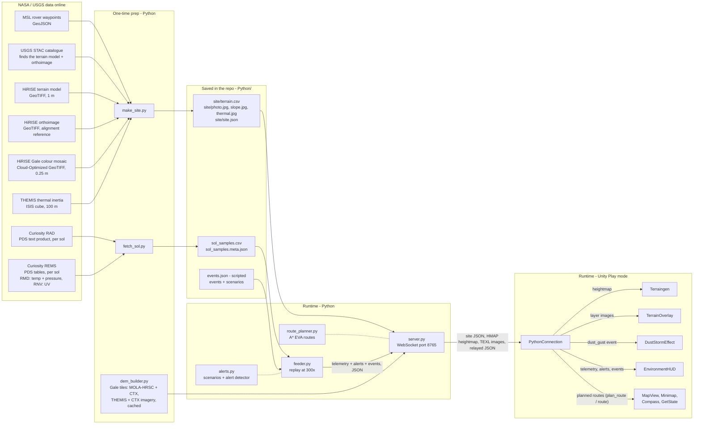
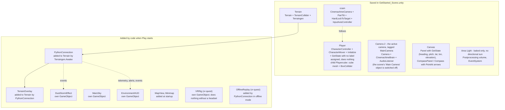
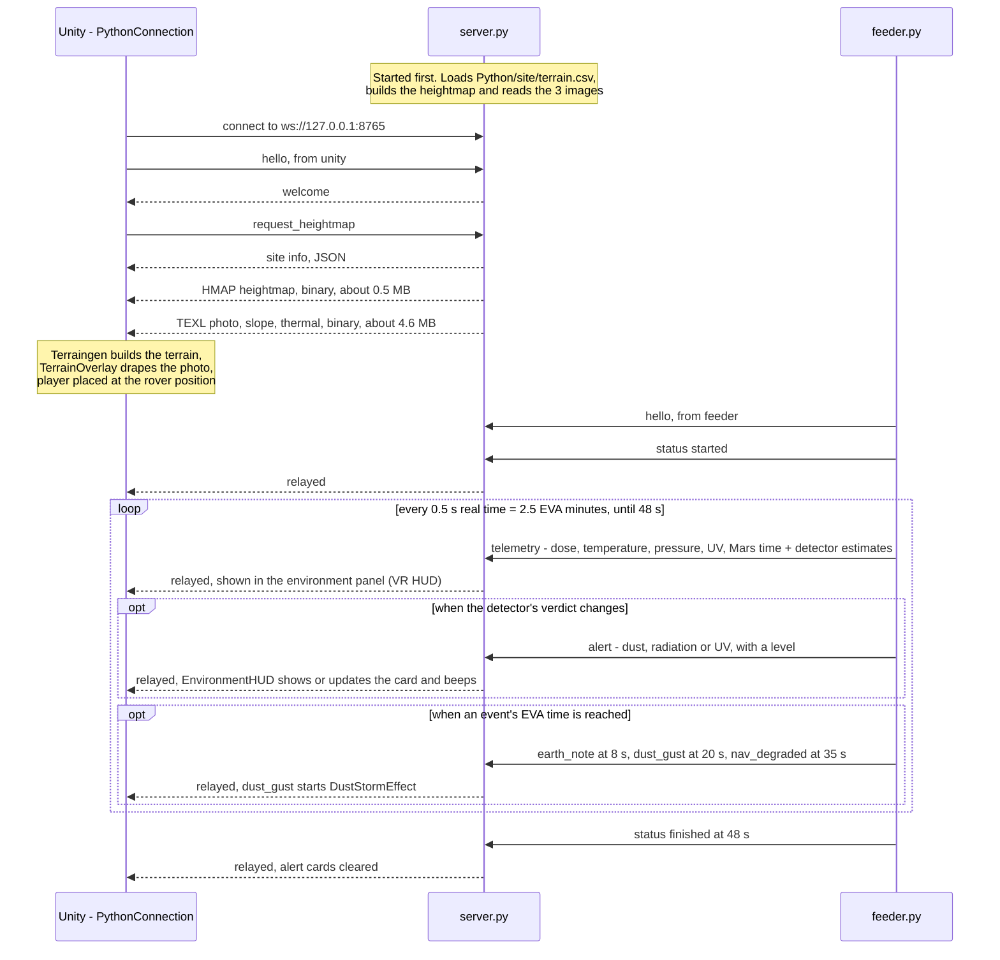
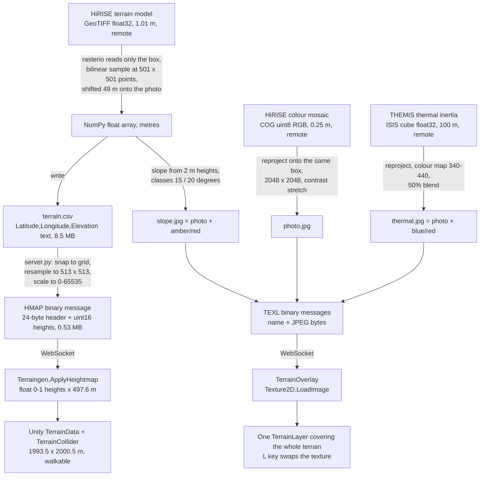
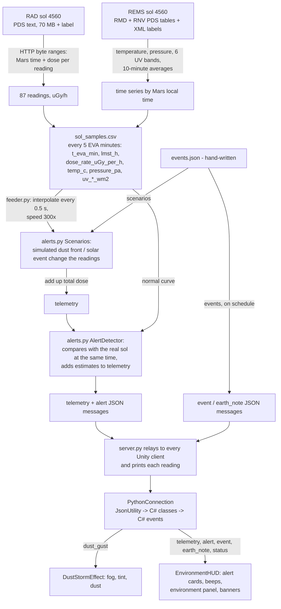

# Marsmap: Project Report

> **Final report.** This describes the finished project as it was demoed. The [Changelog](#13-changelog) at the bottom shows how it got here.
>
> **State described:** the whole project. The demo was recorded in VR on a Meta Quest 3 from branch **`vr-quest`**.
> **Branches:** `main` has the desktop version plus the latest teammate tweaks (F8 green screen, 9 m waypoint arrival, the licence). The VR code (`vr-quest`) and AR mode (`vr-quest-ar`) are being merged into `main`. Things that are only on those branches so far are marked *(vr-quest)* or *(vr-quest-ar)*.
> **Event:** NASA Space Apps Challenge 2026, Seattle. Challenge: [Interplanetary Survival Guide: Martian Map](https://www.spaceappschallenge.org/2026/challenges/interplanetary-survival-guide-martian-map/).
> **Fact-checked** on 14 Nov 2026 against the code, the scene file, git and every linked source; **updated** on 15 Nov 2026 for the final state (environment alerts, the teammates' map, route and minimap features, VR).

## Contents

1. [What the project is](#1-what-the-project-is)
2. [Tech stack](#2-tech-stack)
3. [Architecture](#3-architecture)
4. [How a demo run works, step by step](#4-how-a-demo-run-works-step-by-step)
5. [File tree: what each file does](#5-file-tree-what-each-file-does)
6. [Running the program and the demo](#6-running-the-program-and-the-demo)
7. [Data sources: where every piece of data comes from](#7-data-sources-where-every-piece-of-data-comes-from)
8. [How the data travels, and in what form](#8-how-the-data-travels-and-in-what-form)
9. [Messages between Python and Unity](#9-messages-between-python-and-unity)
10. [Map coordinates and alignment](#10-map-coordinates-and-alignment)
11. [Challenge requirements checklist](#11-challenge-requirements-checklist)
12. [Known limitations and open issues](#12-known-limitations-and-open-issues)
13. [Changelog](#13-changelog)
14. [VR (Meta Quest 3)](#14-vr-meta-quest-3)

---

## 1. What the project is

A first-person Unity demo of a **Marswalk**: an astronaut walking a 2 km × 2 km patch of **Mount Sharp in Gale Crater**, at the exact spot where NASA's Curiosity rover stood on **sol 4560 (4 June 2025)**. NASA dates a sol by the day most of it falls on. Sol 4560 began at about 22:30 UTC on 3 June, which is the date our data files currently store; see [§12](#12-known-limitations-and-open-issues).

- **The ground** is built from a real NASA HiRISE terrain model, with the real HiRISE colour photo draped over it.
- **Two data overlays** can be switched on: a slope-hazard map and a THEMIS thermal map.
- **A bigger map:** the whole Gale crater region can be loaded instead, as a seamless grid of terrain tiles built from USGS MOLA-HRSC and CTX elevation with THEMIS and CTX imagery (`dem_builder.py`).
- **Navigation:**
  - a compass with arrows to the next waypoint and to Home Base;
  - a readout of heading, pitch, latitude, longitude and elevation;
  - a heading-up minimap coloured by slope hazard zones, with an "upcoming hills" profile.
- **Route planning:** an EVA map hologram (M) where you drop waypoints. An A* planner (`route_planner.py`, from the team's notebooks) routes around steep ground and rates the route EASY / MODERATE / HARD with an EVA time.
- **Live conditions:**
  - Radiation and weather readings that Curiosity actually measured on that same sol are replayed in fast-forward.
  - Scripted mission events (an Earth message, a dust gust, a navigation failure) are played alongside.
  - Two **simulated hazards**, a dust front and a solar particle event, change the replayed readings the way real events would.
  - An **alert system** watches the readings and warns the astronaut: early warning for dust storms, and alerts when radiation and UV reach dangerous levels. Readings, alerts and events are shown on screen. See [ALERTS.md](ALERTS.md).

Python prepares the NASA data and serves it over a local WebSocket. Unity builds the world from what it receives. The same scene runs on a desktop and, on branch `vr-quest`, in VR on a **Meta Quest 3**, which is how the demo was recorded ([§14](#14-vr-meta-quest-3)). On branch `vr-quest-ar`, an **AR mode** shows the HUD and the EVA map over the real room through the Quest 3's passthrough ([§14.1](#141-ar-mode-passthrough)).

---

## 2. Tech stack

| Layer | Technology | Version (as tested) | Used for |
|---|---|---|---|
| Game engine | Unity | 6000.6.9f1 (Unity 6.6) | The 3D world, player, camera, effects |
| Rendering | Universal Render Pipeline (URP) | 17.6.0 | Terrain shader (`Terrain/Lit`), fog, skybox |
| Input | Unity Input System | 1.20.1 (the project uses the new Input System only) | Keyboard and mouse; Quest controllers through OpenXR |
| XR | XR Plug-in Management, OpenXR | 4.7.0, 1.18.0 | Meta Quest 3 build (Android, IL2CPP, ARM64, Meta Quest Support feature) |
| Camera | Cinemachine | 6.6.0 | First-person pan/tilt camera locked to the player |
| Networking (Unity) | NativeWebSocket | 2.0.8 (`github.com/endel/NativeWebSocket#upm-2`) | WebSocket client in Unity |
| UI | uGUI + TextMeshPro | 2.6.0 | Compass and nav panel (scene Canvas); IMGUI for the desktop labels, alerts, minimap and route panel; world-space uGUI for the VR HUD |
| Language (Unity) | C# | Unity's C# 9 | All Unity scripts |
| Language (data) | Python | 3.14 in `.venv` (3.10+ supported) | Data download, processing, server, replay |
| WebSocket server | `websockets` | 17.4 (requires ≥ 14) | `server.py`, `feeder.py` |
| Numerics | NumPy | 2.5.4 (requires ≥ 1.26) | Grids, resampling, slope |
| Geospatial | rasterio (GDAL), pyproj | 1.5.2, 3.8.0 | Reading GeoTIFF/ISIS map files over HTTPS, map projections |
| Images | Pillow | 13.0.0 | Writing the JPEG overlays |
| Version control | Git + Git LFS | LFS 3.8.1 | JPEG images are stored through LFS |
| Mapping tool (team) | JMARS (Arizona State University) | n/a | Scouting; manual CSV terrain exports |

Python packages are split in two files:
- **`requirements.txt`:** `numpy`, `websockets`. Enough for the server, feeder, `alerts.py` and `fetch_sol.py` (the last two use only the standard library; `fetch_sol.py` uses `certifi` when it's installed, for the macOS certificate problem).
- **`requirements-maps.txt`:** adds `rasterio`, `pyproj` and `pillow`. Needed for the big Gale map and `--polygon` (`dem_builder.py`), and for `make_site.py`, `raster_to_csv.py` and `prep_terrain.py`.

---

## 3. Architecture

### 3.1 The big picture

There are three stages:
1. **One-time prep:** Python scripts download NASA data and save it as files in the repo.
2. **Runtime (Python):** a WebSocket server and a replay script read those files.
3. **Runtime (Unity):** Unity connects to the server and builds the world.

**Nothing is downloaded while the demo runs** with `--site`. The big Gale map (`server.py` with no arguments) downloads its tiles the first time and caches them in `Python/imagery_cache/`. `gale_terrain_tiles.zip` in the repo root holds a pre-built cache.



The JMARS route still works side by side. A JMARS pixel-export CSV (`Latitude,Longitude,Elevation`) can be served directly with `server.py export.csv`. It gives terrain only, with no photo layers.

### 3.2 What's in the Unity scene

Most of the project's Unity logic is **created by code at runtime**, so it doesn't depend on scene edits. That avoids merge conflicts in the shared scene file.



**There is no sun in the scene.** The only light is the tutorial's "Area Light", which only affects pre-baked lighting. The runtime terrain is lit by ambient light alone, from `MarsSky`, so slopes look flatter than they should. The "sun" steps in `DustStormEffect` and `MarsSky` have nothing to change.

---

## 4. How a demo run works, step by step

This is the run used for the demo: the HiRISE site (`server.py --site`) and the EVA replay. Two other flows are described after the steps: the big Gale map and route planning.



In words:

1. **`server.py` starts.**
   1. It finds `Python/site/terrain.csv`.
   2. It snaps the points to a grid and resamples them to a 513 × 513 heightmap, scaled to 16-bit values.
   3. It reads `site.json` and the three JPEGs into memory.
2. **You press Play in Unity.**
   1. `Terraingen.Awake` makes a flat placeholder terrain and adds `PythonConnection`.
   2. `PythonConnection` connects, retrying every 2 s until the server answers.
   3. While `Terraingen` is still waiting for terrain, `PythonConnection` sends `request_heightmap`.
3. **The server replies with three kinds of message, in order:**
   1. **Site info:** name, sol, centre, and `vertical_exaggeration: 1`, which `PythonConnection` applies to `Terraingen`.
   2. **The heightmap:** `Terraingen.ApplyHeightmap` builds a 1,993.5 × 2,000.5 m terrain with 497.6 m of real relief, rebuilds the collider, centres the terrain on the world origin, and places the player at the centre.
   3. **Three images:** `TerrainOverlay` turns each into a texture and shows the photo first.
4. **If no heightmap arrives within 5 s,** `Terraingen` falls back to random Perlin hills. A server started after that still gets connected and the feeder data flows, but the real terrain is only requested again after restarting Play.
5. **`feeder.py` starts (after Play).**
   1. It builds the whole replay up front as a fixed list of messages: `sol_samples.csv` at 300×, 4 EVA hours in 48 s. `--timeline` prints that list and exits.
   2. **Scenarios** from `events.json` change the readings while they're active: the dust front dims the UV and makes the pressure dip; the solar particle event adds to the dose rate.
   3. The **alert detector** (`alerts.py`) checks each reading against the real sol at the same local time, adds its estimates (UV index, dust opacity, pressure anomaly, normal dose rate) to the telemetry, and emits an `alert` message whenever a level changes.
   4. The scripted events from `events.json` go out on schedule, between telemetry messages.
   5. The server relays everything to Unity, and `PythonConnection` turns each message into a C# event.
6. **What Unity does with the live data:**
   - **`EnvironmentHUD`:**
     - **Alert cards**, top centre: the dust warning counts down the storm's arrival.
     - **Environment panel:** radiation, EVA dose, UV index, dust, pressure and temperature, under the navigation panel. On `main` the desktop panel was removed (`740b21e`); the VR HUD keeps it *(vr-quest)*.
     - **Banners** for events and notes from Earth.
     - **When the EVA finishes,** it clears every alert.
   - **`DustStormEffect`:** the fog and dust start on `dust_gust`.
   - **Unity Console:** `earth_note`, `event`, `status` and new `alert` messages are also logged.
7. **`MarsSky`** replaces the blue tutorial sky with a Mars-coloured sky and warm ambient light when Play starts.

**Other flows:**
- **The big Gale map** (`server.py` with no arguments, or `--polygon`).
  - **Building it:** `dem_builder.py` assembles the terrain. The base is the 200 m MOLA-HRSC DEM, with every overlapping 20 m CTX DTM levelled onto it; the imagery is THEMIS day IR with CTX on top.
  - **Splitting it:** an area too big for one Unity terrain is split into tiles of up to 2,049 × 2,049 points (about 41 km each). Each tile arrives as a `TILE` message (heights) and a `TIMG` message (image), and `Terraingen` joins them into one seamless terrain.
  - **Caching:** results are cached in `Python/imagery_cache/`.
- **Route planning** (press M).
  - **Asking:** `MapView` shows a hologram of the terrain and sends the waypoints in a `plan_route` message.
  - **Planning:** `server.py` plans the route with `route_planner.py` (A* within 18° climbs and 25° side slopes, hazard zones, Tobler EVA time, EASY / MODERATE / HARD) and replies with `route`.
  - **On the ground:** `MapView` draws the route on the hologram, then marks the next waypoint with a beam and ring; the compass arrows point to it (red) and to Home Base (green), and the minimap shows the rest of the route.
- **In VR,** the same messages arrive. Offline, they come from the bundle, through `OfflineReplay` ([§14](#14-vr-meta-quest-3)).

---

## 5. File tree: what each file does

Only project files are listed here. The Unity template's art, audio and tutorial folders are left out.

```text
Marsmap/
├── README.md                         Project front page: what it does, quick start, controls, data, team
├── gale_terrain_tiles.zip            Pre-built Python/imagery_cache/ for the big Gale map (unzip in the repo folder)
├── imagery_cache/                    A copy of some cached tiles (the server reads Python/imagery_cache/)
├── docs/
│   ├── PROJECT_REPORT.md             This report
│   ├── ALERTS.md                     The alert system: thresholds, demo timeline, sources
│   └── VR_QUEST.md                   How to build and run on a Meta Quest 3
├── .gitattributes                    Line-ending + LFS rules; *Terrain*.asset stored as binary, *.jpg via LFS
├── .gitignore                        Unity template + Python ignores (.venv/, __pycache__/, *.pyc, Python/imagery_cache/, *.apk, .DS_Store)
├── Packages/manifest.json            Unity packages (URP, Input System, Cinemachine, NativeWebSocket, ...)
├── Assets/
│   ├── Scenes/GetStarted_Scene.unity The one scene: Terrain, Player, cameras, Canvas (compass, nav panel), Area Light
│   ├── New Terrain.asset             Legacy TerrainData file; not used by the runtime terrain
│   ├── Resources/
│   │   ├── Hologram.shader           The EVA map hologram's see-through look
│   │   └── marsmap_config.json       (vr-quest) Server address, offline mode, VR / AR settings (read at startup)
│   ├── StreamingAssets/Marsmap/      (vr-quest) The headset's offline bundle: terrain + EVA replay (export_offline.py)
│   ├── XR/                           (vr-quest) OpenXR settings (Meta Quest Support, controller profiles; AR features in vr-quest-ar)
│   ├── link.xml                      (vr-quest-ar) Keeps the AR Foundation components in IL2CPP builds
│   └── SourceFiles/
│       ├── InputSystem/InputSystem_Actions.inputactions   Project input actions (Cinemachine look input)
│       └── Scripts/
│           ├── PythonConnection.cs   WebSocket client; routes terrain, tiles, images, telemetry, alerts, events, routes
│           ├── Terraingen.cs         Builds the terrain at runtime (heightmap, Perlin fallback), places player
│           ├── TerrainOverlay.cs     Drapes photo / slope / thermal images on the terrain; L cycles; label
│           ├── CharacterMover.cs     WASD/arrows, Space jump, Shift sprint, Mars gravity (set in the scene)
│           ├── DustStormEffect.cs    Dust gust visuals on the dust_gust event; G = test gust
│           ├── EnvironmentHUD.cs     Alert cards + beeps, event / Earth-note banners (+ environment panel on vr-quest)
│           ├── GreenScreen.cs        F8: the 3D view turns pure green, UI only (chroma-key screenshots)
│           ├── MarsSky.cs            Mars sky gradient, warm ambient light
│           ├── MapView.cs            EVA map hologram (M): waypoints, planned route, beams, Home Base
│           ├── Minimap.cs            Heading-up minimap with hazard zones + "upcoming hills" profile
│           ├── Compass.cs            Compass rose (top-left); PointAt.cs: its waypoint / Home Base arrows
│           ├── GetState.cs           Nav readout: heading, pitch, latitude, longitude, elevation (top-right)
│           ├── OfflineReplay.cs      (vr-quest) Plays the bundled terrain + EVA replay with no server (headset)
│           ├── VR/                   (vr-quest) MarsmapConfig, MarsmapInput (keys + Quest buttons), VRRig (XR rig),
│           │                         VRHud (head-locked HUD sheet), EnvironmentHUDVR, MinimapVR, MapViewVR
│           ├── Initialize.cs         Puts the player on the ground (fallback when no Terraingen)
│           └── CameraFollow.cs, Pickup.cs, UpdateCollectibleCount.cs, MotionAudioController.cs, SimpleMover.cs
│                                     Leftovers from the Unity tutorial template (SimpleMover: an empty stub); not used
└── Python/
    ├── README.md                     How to run the Python side; data source table; demo timeline
    ├── requirements.txt              numpy, websockets (server, feeder, alerts, route planner, fetch_sol)
    ├── requirements-maps.txt         + rasterio, pyproj, pillow (big Gale map, map scripts)
    ├── server.py                     WebSocket server: sends terrain + images, plans routes, relays feeder data
    ├── dem_builder.py                Big-map terrain + imagery for any polygon (MOLA-HRSC + CTX, THEMIS + CTX), cached
    ├── route_planner.py              A* EVA routes with the notebooks' slope zones, Tobler time, difficulty
    ├── Mars_mapping.ipynb, Mars_mapping(3).ipynb   The team's route-planning / trail-recommender notebooks
    ├── feeder.py                     Replays sol_samples.csv + events.json at 300x; --timeline previews it
    ├── alerts.py                     Scripted scenarios (dust front, solar particle event) + the alert detector
    ├── fetch_sol.py                  Downloads one sol of RAD + REMS (incl. UV) -> sol_samples.csv
    ├── make_site.py                  Downloads HiRISE + THEMIS for the rover's position -> site/
    ├── prep_terrain.py               Earlier HiRISE -> Unity RAW heightmap + cost grid tool; helpers reused
    ├── raster_to_csv.py              Any map file -> CSV grid (values, or slope classes)
    ├── export_offline.py             (vr-quest) Writes the headset's offline bundle to Assets/StreamingAssets/Marsmap/
    ├── events.json                   Scripted demo events and scenarios (hand-written)
    ├── sol_samples.csv               REAL replay data: sol 4560, 09:00-13:00 Mars time, every 5 EVA min (49 rows):
    │                                 dose rate, temperature, pressure, 6 REMS UV bands
    ├── sol_samples.meta.json         Exact NASA files sol_samples.csv came from
    └── site/
        ├── terrain.csv               REAL heights: 501 x 501 points, 4 m apart (Latitude,Longitude,Elevation)
        ├── photo.jpg                 REAL HiRISE colour photo of the same box, 2048 px (~1 m/px)
        ├── slope.jpg                 Photo + slope hazard colours computed from the HiRISE heights
        ├── thermal.jpg               Photo + THEMIS thermal inertia colours
        └── site.json                 Site name, sol, centre, box, layer labels/credits, source URLs, alignment shift
```

### 5.1 Unity scripts in more detail

| Script | Written by | What it does | Key details |
|---|---|---|---|
| `PythonConnection.cs` | Merged, ours + teammate | WebSocket link to `server.py` | Reconnects every 2 s. Routes `HMAP` to `Terraingen` and `TEXL` to `TerrainOverlay`; turns JSON into C# events (`TelemetryReceived`, `AlertReceived`, `EventReceived`, `EarthNoteReceived`, `StatusReceived`, `SiteReceived`). Logs events, alerts and status, not telemetry. Asks for terrain only while `Terraingen.WaitingForHeightmap`. Catches handler errors so one bad message can't stop the stream. |
| `Terraingen.cs` | Teammate (small edits by us) | Builds `TerrainData` at runtime | Placeholder in `Awake`. Heightmap from Python, or Perlin fallback after 5 s. Colours by height (matte), recentres the terrain at the world origin, places the player, aims the Cinemachine camera. Default vertical exaggeration 5×; the HiRISE site sets 1×. |
| `TerrainOverlay.cs` | Ours | Shows site images on the terrain | One `TerrainLayer` the size of the terrain (`tileSize` = terrain size), so the image covers it exactly once. **L** cycles photo → slope → thermal → height colours. IMGUI label bottom-left. |
| `CharacterMover.cs` | Teammate (edits by us) | Player movement | Adds default WASD/arrow and Space bindings if none are set in the Inspector. Walking 5 m/s, Shift = 3× sprint. Gravity −3.72 m/s² (Mars) is set on the Player in the scene; the script's own default is −7.42, so a newly added `CharacterMover` needs it set again. Movement direction follows the Cinemachine pan angle. Slopes don't slow or block movement. |
| `EnvironmentHUD.cs` | Ours | Alerts and readings on screen (IMGUI, created at runtime) | **Alert cards** (top centre), one per hazard, most severe first: advisory yellow, warning orange, danger red and pulsing. Each is tagged as real data or simulated. A dust warning counts the storm's arrival down on the EVA clock. Synthesized beeps when an alert appears or gets worse. **Banners** for events, notes from Earth and cleared alerts (6 s). **Environment panel** under the navigation panel (on `main` the desktop panel was removed in `740b21e`; the VR HUD keeps it), values coloured by alert level; hidden while the map (M) is open. Everything clears when the EVA finishes. |
| `GreenScreen.cs` | Teammate | Screenshot helper | **F8** turns every camera that draws to the screen to a pure green background with nothing drawn, so only the UI shows (compass, minimap, nav panel, alerts); F8 again brings the world back. Cameras that render into a texture (the minimap) are left alone, and the dust tint is hidden. |
| `DustStormEffect.cs` | Ours | Dust gust visuals | On `dust_gust`: orange exponential-squared fog (peak density 0.03, ground hidden past ~80 m), 42% screen tint, up to 2,200 wind-blown dust particles per second around the camera. Fades in 3 s, holds, fades out 4 s; restores the scene settings afterwards. It would also dim and warm a directional sun, but the scene has none. **G** = test. |
| `MarsSky.cs` | Ours | Mars sky look | Builds a sky gradient texture on the built-in `Skybox/Panoramic` shader, sets warm trilight ambient and reduces sky reflections. It would also warm a directional sun, but the scene has none, so the warm look comes from the sky and ambient light alone. Restored when Play stops. |
| `GetState.cs` | Teammate (layout by us) | Navigation readout | Heading (with N/NE/…), pitch, latitude, longitude and the ground elevation under you, from the map Python sent (a dash on the Perlin fallback). Styled top-right at startup. The copy on Canvas > Panel works; the copy on the Player has no label assigned and does nothing. |
| `Compass.cs`, `PointAt.cs` | Teammates | Compass | Compass rose top-left that turns with your heading; two arrows ride round it: red = next waypoint, green = Home Base. |
| `MapView.cs` | Teammates | EVA map and route | **M** opens a hologram of the terrain coloured by hazard zones. Drag to turn/tilt, scroll to zoom, WASD to move, click to add a waypoint, Shift+click to remove; T top-down, F centre, Backspace undo, C clear, R return to Home Base. Sends `plan_route`, draws the planned route and its numbers (distance, EVA time, climb, steepest slopes, ground by zone, hazards). On the ground: the current leg, a beam and ring at the next waypoint, Home Base's sphere and beam. |
| `Minimap.cs` | Teammates | Minimap | Bottom-left, heading-up, shaded terrain with contours coloured by hazard zone (0–10° / 10–20 / 20–30 / >30), the route still ahead, waypoints, Home Base. **H** plain colours, **+ / −** zoom. "Upcoming hills": the elevation profile of the next stretch. |
| `VR/` scripts | Ours (map / minimap VR by teammates) | Meta Quest 3 | See [§14](#14-vr-meta-quest-3). |
| `Initialize.cs` | Teammate | Ground placement | Puts the player on the terrain surface; does nothing when `Terraingen` handles it. |

### 5.2 Python scripts in more detail

| Script | When you run it | Input | Output |
|---|---|---|---|
| `make_site.py` | Once per site (~20 s) | NASA rover waypoints; USGS STAC catalogue; HiRISE terrain model, orthoimage and colour mosaic, and THEMIS mosaic, all read remotely, box only | `Python/site/` (CSV + 3 JPEGs + `site.json`) |
| `fetch_sol.py` | Once per sol (~1 min) | RAD and REMS files (RMD for temperature and pressure, RNV for UV) for one sol from the NASA Planetary Data System (PDS) | `sol_samples.csv` + `sol_samples.meta.json` |
| `server.py` | Every demo (terminal 1) | `site/` (`--site`), the big Gale map (no arguments, via `dem_builder.py`), a `--polygon`, a JMARS CSV, or `--demo` | WebSocket on port 8765; plans routes with `route_planner.py` |
| `feeder.py` | Every demo (terminal 2, after Play) | `sol_samples.csv`, `events.json` | Live JSON messages, 48 s (telemetry, alerts, events). `--timeline` prints the alerts and events without a server |
| `alerts.py` | Used by `feeder.py` | Telemetry as it's sent; the real sol as the "normal" curve | Changed readings (scenarios), detector estimates, `alert` messages |
| `route_planner.py` | Used by `server.py` | A `plan_route` message and the terrain being served | A `route` reply: path, legs, distance, Tobler EVA time, climb, hazards, EASY / MODERATE / HARD |
| `dem_builder.py` | Used by `server.py` (default Gale map, `--polygon`) | A polygon; MOLA-HRSC DEM, USGS CTX DTMs and orthoimages, THEMIS day IR, read remotely | Terrain tiles + images, cached in `Python/imagery_cache/` |
| `export_offline.py` *(vr-quest)* | Before a headset build | The same inputs as `server.py` + `feeder.py` | The offline bundle in `Assets/StreamingAssets/Marsmap/` |
| `raster_to_csv.py` | Optional | Any GeoTIFF / ISIS map file | CSV grid of values or slope classes |
| `prep_terrain.py` | Optional, older tool | HiRISE terrain model + photo | Unity RAW heightmap, cost grid, `meta.json`; also provides helpers that `make_site.py` uses |

---

## 6. Running the program and the demo

### 6.1 One-time setup

```bash
# from the Marsmap folder
python3 -m venv .venv
.venv/bin/pip install -r Python/requirements.txt
.venv/bin/pip install -r Python/requirements-maps.txt   # for the big Gale map, or to regenerate map data
# Windows: .venv\Scripts\pip install -r Python\requirements.txt
```

Unity: open the project in **Unity 6000.6.9f1** and open `Assets/Scenes/GetStarted_Scene.unity`. The NativeWebSocket package installs itself from GitHub. Git LFS must be installed to get the JPEGs: GitHub Desktop includes it; on the command line run `git lfs install`.

The site and sol data are already generated and committed. You only need these two commands to change location or sol:

```bash
.venv/bin/python Python/make_site.py --sol 4560            # map data for where the rover was on that sol
python3 Python/fetch_sol.py --sol 4560 --start-lmst 9:00   # radiation + weather for that sol
```

### 6.2 Running the demo

```bash
python3 Python/server.py --site   # terminal 1: the HiRISE site at Curiosity (the demo); wait for "Server listening"
python3 Python/server.py          #   ...or the big Gale crater map (tiles; unzip gale_terrain_tiles.zip first to skip downloads)
# press Play in Unity
python3 Python/feeder.py          # terminal 2, while Unity is in Play mode
```

For a Meta Quest 3, add `--host 0.0.0.0` and see [docs/VR_QUEST.md](VR_QUEST.md).

`server.py` and `feeder.py` relaunch themselves inside `.venv`, so plain `python3` works.

### 6.3 Controls

| Key | Action |
|---|---|
| W A S D / arrow keys | Walk (5 m/s) |
| Mouse | Look |
| Space | Jump (in Mars gravity) |
| Hold Left Shift | Move 3× faster (the site is 2 km across) |
| L | Next map layer: photo → slope hazard → thermal → height colours |
| G | Test dust gust (no feeder needed) |
| + / −, H | Minimap zoom; hazard / plain colours |
| M | EVA map hologram (see `MapView.cs` in [§5.1](#51-unity-scripts-in-more-detail) for its keys) |
| Enter | Start the EVA replay in offline mode |
| — | Alerts need no keys: they appear and clear by themselves |

Quest 3 controls are in [docs/VR_QUEST.md](VR_QUEST.md#controls).

Click inside the Game view first so it has keyboard focus.

### 6.4 Demo timeline (default speed, 300×)

Run `python3 Python/feeder.py --timeline` to print this list from the current settings.

| Real time | What you see | Driven by |
|---|---|---|
| 0 s | **UV BEYOND EARTH RECORD** (UV index ~45); environment panel appears (VR HUD) | real UV |
| ~8 s | Banner: note from Earth, "Science team: image the vein at Stop 2 before sampling." | script |
| ~15.5 s | **DUST WATCH**: UV 6% below normal, dust building | detector, simulated dust |
| ~17 s | DUST WATCH update: 3.7 Pa pressure dip, a dust devil lifting dust | detector |
| ~18–19.5 s | **DUST WARNING** with the storm's arrival counted down | detector (the early warning) |
| ~20 s | Dust gust (11 s): fog, orange tint, blowing dust; **DUST STORM** (UV down 46%) | script + detector |
| ~31 s | **UV DANGER**: the dust clears and UV index jumps to ~165 | real UV |
| ~33 s | DUST CLEARED | detector |
| ~35 s | Banner: navigation degraded | script |
| ~38 s | **RADIATION RISING** (1.36× normal) | detector, simulated solar event |
| ~39 s | **SOLAR PARTICLE EVENT** confirmed: end the EVA | detector |
| ~44.5 s | **RADIATION: SHELTER NOW** (179 µGy/h) | detector |
| ~48 s | EVA finished: alerts clear, "EVA COMPLETE" banner with the dose (0.144 mGy) | |

Change times and scenario shapes in `Python/events.json` (`t_eva_min`, where 1 EVA minute = 0.2 s at 300×), thresholds at the top of `Python/alerts.py`, or the speed with `--speed`.

### 6.5 Troubleshooting

| Symptom | Cause | Fix |
|---|---|---|
| Rolling smooth hills, no photo, L does nothing | No heightmap arrived within 5 s: Console says "Can't reach…", then "Perlin fallback" | Start `server.py` **before** pressing Play, or restart Play after starting it |
| `address already in use` when starting the server | Another server is already on port 8765 | Stop it (`lsof -nP -iTCP:8765`), or use `--port` |
| No dust, no alerts, no events | `feeder.py` wasn't running during Play, or started before Unity connected | Press Play first, then start `feeder.py` |
| Keys do nothing | The Game view doesn't have focus | Click inside the Game view |
| Fake sine-wave hills 20 km wide | Server started with `--demo` | Run it without `--demo` |
| No alerts (or, in VR, no environment panel) | No telemetry has arrived yet | Start `feeder.py`; the panel appears with the first reading |

---

## 7. Data sources: where every piece of data comes from

### 7.1 Summary: what's real

| What you see / receive | Real? | Source |
|---|---|---|
| Starting point / map centre | ✅ Real | Curiosity's position on sol 4560 (NASA/JPL waypoints) |
| Ground shape | ✅ Real | HiRISE terrain model `DTEEC_019698_1750_019988_1750_U01` |
| Photo layer | ✅ Real (colour-enhanced) | HiRISE colour version of the MSL Gale orthophoto mosaic |
| Slope hazard layer | ✅ Computed from real heights | HiRISE terrain model; 15°/20° limits borrowed from Artemis lunar EVA planning |
| Thermal layer | ✅ Real | Mars Odyssey THEMIS thermal inertia |
| Big Gale map (tiles) | ✅ Real | USGS MOLA-HRSC 200 m DEM + CTX 20 m DTMs; THEMIS day IR + CTX imagery (`dem_builder.py`) |
| Planned routes, EVA time, difficulty | ✅ Computed from real heights | `route_planner.py`, rules from the team's `Mars_mapping(3).ipynb` |
| Radiation dose | ✅ Real, time-compressed | Curiosity RAD, sol 4560 |
| Temperature, pressure, Mars time | ✅ Real, time-compressed | Curiosity REMS, sol 4560 |
| UV (6 bands) | ✅ Real, time-compressed | Curiosity REMS UV sensor, sol 4560 |
| UV index, dust opacity, "normal" dose rate | 🟡 Estimates computed from real data | `alerts.py`; method and caveats in [ALERTS.md](ALERTS.md) |
| Dust front, solar particle event | ❌ Simulated, shaped on measured Mars events | `events.json` scenarios; the readings are changed while they're active and the HUD says **SIMULATED** |
| Alert thresholds | ✅ From published sources (a few are our own choices, marked) | [ALERTS.md](ALERTS.md) |
| Gravity | ✅ Real constant | 3.72 m/s² |
| Earth note, dust gust, nav failure | ❌ Scripted | `Python/events.json` |
| Dust visuals, sky colour | ❌ Artistic | `DustStormEffect.cs`, `MarsSky.cs` |
| Wind | Not available | REMS wind sensor has returned no data for years |
| Perlin hills / demo sine hills | ❌ Fake fallbacks | Only when no heightmap arrives or the server runs with `--demo` |

### 7.2 Each source in detail

#### Curiosity rover position: NASA/JPL MSL waypoints
- **Link:** <https://mars.nasa.gov/mmgis-maps/MSL/Layers/json/MSL_waypoints.json>
- **Background:** JPL's MMGIS mapping system publishes Curiosity's position after every drive. It's the data behind NASA's "Where is Curiosity?" map. The file is GeoJSON with one feature per waypoint (sol, latitude, longitude, elevation, drive distance).
- **Used:** sol 4560 → **latitude −4.79984723°, longitude 137.3835414° E**. `make_site.py` centres the 2 km box there, so you start where the rover was on the same sol as the replayed weather and radiation.

#### Terrain heights: HiRISE digital terrain model (DTM)
- **Link (file used):** <https://astrogeo-ard.s3-us-west-2.amazonaws.com/mars/mro/hirise/controlled/dtm/ESP_019698_1750_ESP_019988_1750/DTEEC_019698_1750_019988_1750_U01.tif>
- **Catalogue:** USGS Astrogeology STAC catalogue of HiRISE terrain models; `make_site.py` uses it to find the terrain model and its orthoimages. [Browser](https://stac.astrogeology.usgs.gov/browser-dev/#/api/collections/mro_hirise_socet_dtms) · [API](https://stac.astrogeology.usgs.gov/api/collections/mro_hirise_socet_dtms) · [docs](https://stac.astrogeology.usgs.gov/docs/data/mars/hirise_dtms/)
- **Background:**
  - **The camera:** HiRISE (High Resolution Imaging Science Experiment) is the camera on NASA's Mars Reconnaissance Orbiter, operated by the University of Arizona.
  - **How heights are measured:** terrain models are computed from **stereo pairs**, two images of the same ground taken from different angles. This one comes from images `ESP_019698_1750` and `ESP_019988_1750`.
  - **Format:** USGS distributes them as analysis-ready, cloud-optimized GeoTIFFs: float32 elevations in metres, ~1.01 m pixels, in an equirectangular map projection on a 3,396.19 km Mars sphere.
- **Used:** the 2 km box only, read over HTTPS without downloading the whole file. Elevation −3,875.6 to −3,377.9 m, so 497.7 m of relief in the box, no missing data. That's 497.6 m after `server.py` resamples it to the 513 × 513 heightmap, which is the figure Unity uses. Also the source for the slope layer.

#### Photo layer: colour MSL Gale orthophoto mosaic (HiRISE)
- **Link (file used):** <https://asc-pds-services.s3.us-west-2.amazonaws.com/mosaic/Mars/MSL/MSL_Gale_HiRISE-LRGB_78quads_sharp_cog.tif>
- **Product page:** <https://astrogeology.usgs.gov/search/map/mars_msl_gale_merged_orthophoto_mosaic_25cm>
- **Background:**
  - **What it is:** the colour version, added July 2025, of the *MSL Gale Merged Orthophoto Mosaic*. That mosaic is the 25 cm/pixel base map for the Curiosity mission's science and engineering operations, and the rover's positions are mapped in the same frame.
  - **Who made it:** Timothy Parker and Fred J. Calef III. The originators are JPL-Caltech, NASA, USGS Astrogeology and the University of Arizona; USGS Astrogeology publishes it.
  - **How it was made:** HiRISE colour strips (78 quads) were georectified with manually placed tie-points and fused onto the mission's grey-scale HiRISE RED orthophoto mosaic. The result was lightly sharpened and saved as a JPEG-compressed Cloud-Optimized GeoTIFF.
  - **Colour:** the product page makes no natural-colour claim, so treat the colour as enhanced, not as what an eye would see.
  - **Coverage and download:** the colour file covers about 9 × 19 km of Curiosity's Mount Sharp traverse. The product page's main download is the older grey-scale version; the colour file is described in its "NEW (July 2025)" note.
- **Used:** cropped to the box, reduced to 2048 × 2048 px (~0.98 m/pixel), contrast-stretched, saved as `photo.jpg`. Also the base of the slope and thermal images.

#### Alignment reference: HiRISE orthoimage
- **Link:** <https://astrogeo-ard.s3-us-west-2.amazonaws.com/mars/mro/hirise/controlled/dtm/ESP_019698_1750_ESP_019988_1750/ESP_019988_1750_RED_C_01_ORTHO.tif>
- **Why:** the terrain model and the Gale mosaic sit on slightly different base maps, about 49 m apart here. `make_site.py` compares this orthoimage (which matches the terrain model's grid) with the mosaic and moves the terrain onto the mosaic: 34.18 m west and 34.79 m north, match correlation 0.73. See [§10](#10-map-coordinates-and-alignment).

#### Thermal layer: Mars Odyssey THEMIS thermal inertia
- **Link (file used):** <https://asc-astropedia.s3.us-west-2.amazonaws.com/Mars/Odyssey/THEMIS-Global-Thermal-Inertia-Mosaic/Quantitative-32-Bit/THEMIS_TI_Mosaic_Quant_30S120E_100mpp.cub>
- **Product page:** <https://astrogeology.usgs.gov/search/map/themis_thermal_inertia_mosaic_quantitative_30s120e_100mpp>. The tile covers latitude −30 to 0 and longitude 120–180° E, which includes Gale.
- **Background:**
  - **The instrument:** THEMIS (Thermal Emission Imaging System) on NASA's 2001 Mars Odyssey orbiter, operated by Arizona State University.
  - **What it measures:** **thermal inertia** is how strongly the ground resists changing temperature between day and night, in J m⁻² K⁻¹ s⁻½. Loose dust and fine sand change temperature quickly (low values); rock and hard ground change slowly (high values). That makes it a proxy for "sandy vs. rocky".
  - **Format:** an ISIS3 cube of float32 values at 100 m per pixel.
- **Used:** about 20 × 20 THEMIS pixels cover the box, with values 320–450. They're colour-mapped from blue (340) to red (440) and blended 50% over the photo as `thermal.jpg`. The scale is relative to this box.

#### Radiation: Curiosity RAD (Radiation Assessment Detector)
- **Archive:** <https://pds-ppi.igpp.ucla.edu/data/MSL-M-RAD-3-RDR-V1.0/> (NASA Planetary Data System, Planetary Plasma Interactions node, UCLA)
- **Files used, sol 4560:**
  - Label: <https://pds-ppi.igpp.ucla.edu/data/MSL-M-RAD-3-RDR-V1.0/DATA/SOL_04489_04612/RAD_RDR_2025_154_22_44_4560_V00.LBL>
  - Data: <https://pds-ppi.igpp.ucla.edu/data/MSL-M-RAD-3-RDR-V1.0/DATA/SOL_04489_04612/RAD_RDR_2025_154_22_44_4560_V00.TXT>
- **Background:**
  - **The instrument:** RAD was built by Southwest Research Institute together with Christian-Albrechts-Universität zu Kiel (Germany). It measures the energetic-particle radiation reaching Mars's surface (galactic cosmic rays, solar particles, secondary neutrons). That's the radiation an astronaut would absorb.
  - **The data:** each sol's calibrated data is one ~70 MB text file, split into observation periods of about 16 minutes. Each period is stored as a pair of blocks:
    - the first holds the Mars local time and a **total dose rate** in µGy/h from two detectors, **B** (silicon) and **E** (plastic, closer to human tissue);
    - the second holds only a pulse-height table.
- **Used:**
  - **Detector E.** The file has 87 dose readings across the whole sol (4.27–6.85 µGy/h). 15 of them fall in the 09:00–13:00 EVA window (5.96–6.39 µGy/h), and `sol_samples.csv` interpolates between them every 5 EVA minutes (5.96–6.38 µGy/h).
  - **Partial download:** `fetch_sol.py` reads the label to find each reading's byte position and downloads only those bytes.
  - **Total dose:** the feeder adds up the total dose over the EVA: about 0.025 mGy (it reports 0.0246 mGy) for the 4-hour EVA on the real data alone, and 0.144 mGy with the simulated solar particle event.

#### Weather: Curiosity REMS (Rover Environmental Monitoring Station)
- **Archive:** <https://atmos.nmsu.edu/PDS/data/mslrem_1001/> (NASA Planetary Data System, Atmospheres node, New Mexico State University)
- **Files used, sol 4560:**
  - `RMD` (temperature, pressure): <https://atmos.nmsu.edu/PDS/data/mslrem_1001/DATA/SOL_04489_04612/SOL04560/RME_802257765RMD45600000000_______P1.TAB>
  - `RNV` (UV): <https://atmos.nmsu.edu/PDS/data/mslrem_1001/DATA/SOL_04489_04612/SOL04560/RME_802257765RNV45600000000_______P1.TAB>
- **Background:**
  - **The instrument:** REMS, provided by Spain's Centro de Astrobiología, measures air and ground temperature, pressure, humidity and UV.
  - **Wind:** its wind sensor has returned no data for these sols.
  - **Product:** the `RMD` product is the processed version: a comma-separated table of about 27,700 timestamped samples per sol, with columns described in a PDS4 XML label.
- **Used:**
  - **Temperature and pressure:** `AMBIENT_TEMP` (kelvin → °C) and `PRESSURE` (Pa) from `RMD`, by Mars local time, averaged into 10-minute bins. Over the EVA window (09:00–13:00 Mars local time): **−56 °C warming to −41 °C**, and **797 to 767 Pa**.
  - **UV:** the six UV sensor bands from `RNV` (the calibrated environmental product), in W/m², averaged the same way.
    - **Why RNV:** the `RMD` product marks midday UV as unknown (−999).
    - **Bands:** A 315–370 nm, B 280–320, C 220–280, ABC 200–370, D 230–290, E 300–350.
    - **Over the EVA window:** UV-ABC 4.0–8.9 W/m² and UV-C 0.28–0.84 W/m². UV-C never reaches the ground on Earth.
    - **Uses:** the alert system turns these into an estimated UV index (about 45 at 09:00, up to about 195 later in the morning) and uses the dimming of UV-ABC to detect dust. See [ALERTS.md](ALERTS.md).
- **Also available but not used:** NASA's REMS weather feed, <https://mars.nasa.gov/rss/api/?feed=weather&category=msl&feedtype=json>. It gives one summary per sol (minimum and maximum air and ground temperature, one pressure value, UV index, sunrise and sunset) rather than a time series. It is more up to date than the PDS archive and currently reaches sol 4995 (25 Aug 2026).

#### Scripted events and scenarios: `Python/events.json` (not real data)
- **Events:** an Earth message, a dust gust and a navigation failure, each hand-written with an EVA time. The gust's `duration_min` is in EVA minutes; the feeder converts it to real seconds.
- **Scenarios** (`"type": "scenario"`) change the real readings while they're active:
  - **`dust_front`:** extra dust opacity builds over 35 EVA minutes before the gust, up to +2.0. It dims the real UV (`× exp(−0.4 × opacity)`), lowers the pressure by up to 2 Pa with two dust-devil dips (0.8 and 3.2 Pa), and cools the air by 3 °C.
  - **`solar_particle_event`:** adds to the real dose rate, shaped on the 20 May 2024 event at Gale: a 334 µGy/h peak 53 minutes after onset, then a slow decline.
- **What they're based on:** magnitudes follow measured Mars events; the timing is compressed for the demo. Sources are in [ALERTS.md](ALERTS.md).

#### Alert thresholds (published sources)
Every alert level is tied to a source in [ALERTS.md](ALERTS.md). The main ones:
- **Radiation:** the RAD team's 1.25× background trigger for solar particle events; NASA SRAG's 150 µGy/h shelter level for Orion.
- **UV:** the WHO UV index scale; Earth's record UV index of 43; Gale's measured midday UV.
- **Dust:** UV-based dust opacity criteria from Curiosity and Perseverance studies.

#### Big Gale map: USGS MOLA-HRSC, CTX and THEMIS (`dem_builder.py`)
- **Elevation base:** [Mars MOLA-HRSC blended DEM, 200 m/px](https://asc-pds-services.s3.us-west-2.amazonaws.com/mosaic/Mars/HRSC_MOLA_Blend/Mars_HRSC_MOLA_BlendDEM_Global_200mp_v2.tif) (USGS Astrogeology), whole planet.
- **Elevation detail:** every USGS CTX DTM (20 m/px; collection `mro_ctx_controlled_usgs_dtms`) that overlaps the polygon, found through the [USGS STAC API](https://stac.astrogeology.usgs.gov/api/search).
  - Each DTM is levelled onto the base (offset + tilt), noisy ones are skipped, and the edges are feathered.
  - At most 60 DTMs are used per polygon.
- **Imagery:** THEMIS day IR (100 m/px) as the base, with the CTX orthoimages (6 m/px) that belong to the DTMs on top, brightness-matched.
- **How it's read:** all of it is Cloud-Optimized GeoTIFF read remotely with rasterio, cached in `Python/imagery_cache/`.
- **Used:** the default `server.py` area is Gale crater (`DEFAULT_POLYGON`, about 3.8–6.9° S, 135.4–139.7° E), split into terrain tiles.

#### JMARS (team tool)
- **Link:** <https://jmars.asu.edu/>
- **Background:** JMARS is Arizona State University's Mars GIS tool.
- **How the team uses it:** scouting, and manual CSV exports (`Latitude,Longitude,Elevation`) that `server.py` can serve as terrain. No JMARS export is committed yet.
- **Finding the site in JMARS:** centre −4.79985°, 137.38354° E; box latitude −4.81672 to −4.78298, longitude 137.36667 to 137.40041 E.

---

## 8. How the data travels, and in what form

### 8.1 Map data (terrain + images)



| Stage | Form | Where |
|---|---|---|
| Online source | GeoTIFF / COG / ISIS cube, read in place over HTTPS | NASA/USGS servers |
| Prep | NumPy arrays in the terrain model's map projection | `make_site.py` |
| Saved | CSV (heights), JPEG (images), JSON (metadata) | `Python/site/` |
| Served | Binary `HMAP` + binary `TEXL` + JSON `site` WebSocket frames | `server.py` |
| In Unity | `float[,]` heights → `TerrainData`; JPEG → `Texture2D` → `TerrainLayer` | `Terraingen`, `TerrainOverlay` |

### 8.2 Live data (radiation, weather, events)



| Stage | Form | Where |
|---|---|---|
| Online source | PDS3 text product (RAD), PDS4 table (REMS) | NASA PDS archives |
| Saved | `sol_samples.csv`: 49 rows, one every 5 EVA minutes; `.meta.json` lists the exact source files | `Python/` |
| Changed and checked | Python dicts: scenarios change the readings, the detector adds estimates and alerts | `alerts.py` |
| Replayed | JSON text messages, about 2 per second | `feeder.py` → `server.py` |
| In Unity | `TelemetryMessage`, `AlertMessage`, `EvaEventMessage`, `EarthNoteMessage`, `StatusMessage` C# objects, via C# events | `PythonConnection` → `EnvironmentHUD`, `DustStormEffect` |

---

## 9. Messages between Python and Unity

All messages go through one WebSocket server on port 8765. Unity connects to `ws://127.0.0.1:8765` and `feeder.py` to `ws://localhost:8765`, each with its own connection, and the server relays between them. JSON messages carry `"v": 1` (schema version) and `"type"`, except Unity's `request_heightmap`, which has only `"type"`.

| Type | Direction | Format | Content |
|---|---|---|---|
| `hello` | Unity → server, feeder → server | JSON | `{"from": "unity"}` or `{"from": "feeder"}`. A feeder becomes a data source; everyone else is a viewer |
| `welcome` | server → client | JSON | Confirms the role |
| `request_heightmap` | Unity → server | JSON | Sent only while `Terraingen` is still waiting for terrain |
| `site` | server → Unity | JSON | `name, sol, earth_date, center_lat, center_lon, size_m, vertical_exaggeration, layers[{name,label,credit}]` |
| `HMAP` | server → Unity | Binary | `"HMAP"`, int32 resolution N, float32 min elevation, max elevation, size X (m), size Z (m), then N×N uint16 (row 0 = south, column 0 = west) |
| `TEXL` | server → Unity | Binary | `"TEXL"`, int32 name length L, L bytes name (`photo` / `slope` / `thermal`), then the JPEG file bytes |
| `TILE` | server → Unity | Binary | Big map, one per tile: `"TILE"`, int32 ix, iz (column from west, row from south), nx, nz, count, res; float32 min / max elevation (the same for every tile, so edges match), tile size X, Z (m); then res×res uint16 heights |
| `TIMG` | server → Unity | Binary | Right after its tile: `"TIMG"`, int32 ix, iz, then a PNG covering exactly that tile, north up |
| `plan_route` | Unity → server | JSON | `id, x[], z[]` (waypoints in Unity world metres, first = the astronaut), `loop`, `return_to_start` |
| `route` | server → Unity | JSON | `id, ok, error, x, z, elev, tier, legs[]` (each: `from_wp, to_wp, ok, distance_m, minutes, start_index, end_index`), `distance_m, minutes, gain_m, loss_m, max_climb_deg, max_descent_deg, max_side_deg, difficulty, score, zone_pct, hazards, spacing_m` |
| `status` | feeder → Unity | JSON | `state: started` (with `speed`) / `finished` (with `dose_total_mGy`) |
| `telemetry` | feeder → Unity | JSON | `t_eva_s, lmst_h, dose_rate_uGy_h, dose_total_mGy, temp_c, pressure_pa, uv_a_wm2 … uv_e_wm2, source`; detector estimates `uv_index, dust_tau, pressure_anomaly_pa, dose_expected_uGy_h`; `scenario` (active simulated scenarios, empty if none) |
| `alert` | feeder → Unity | JSON | `t_eva_s, category (dust / radiation / uv), level (advisory / warning / danger / clear), title, text, update, value`, optional `eta_min` (dust warning: predicted storm arrival in EVA minutes). `clear` removes the card; `update: true` = same level, new details |
| `event` | feeder → Unity | JSON | `t_eva_s, id (dust_gust / nav_degraded), severity, text`, optional `duration_s` (converted from the script's `duration_min`) |
| `earth_note` | feeder → Unity | JSON | `t_eva_s, text, delay_s` (Mars–Earth one-way light delay, 840 s in the script) |

A Unity client that connects late is immediately sent the last `status` and `telemetry`.

---

## 10. Map coordinates and alignment

```text
                 North (image top row, terrain-local z = 2000.5 m)
        NW (-4.782977, 137.366671)        NE (-4.782977, 137.400412)
          +----------------------------------------+
          |                                        |
          |                                        |
  West    |              * Curiosity, sol 4560     |    East
 (local   |         (-4.799847, 137.383541)        | (local
  x = 0)  |      = terrain centre = spawn point    |  x = 1993.5 m)
          |                                        |
          +----------------------------------------+
        SW (-4.816718, 137.366671)        SE (-4.816718, 137.400412)
                 South (heightmap row 0, terrain-local z = 0)
```

- **Box:**
  - **On the ground:** about 1,993 m east–west × 2,000 m north–south. The map projection stretches east–west distances slightly at this latitude.
  - **In Unity:** 1,993.5 × 2,000.5 m, because `server.py` converts degrees with a rounded 59.29 km per degree, a 0.03% difference.
  - The heights and images use the same box, so they still line up.
- **Coordinates:** planetocentric latitude, **east** longitude (0–360°), the JMARS default.
- **Orientation:** nothing is ever flipped.
  - **Heightmap:** row 0 = south, column 0 = west.
  - **Images:** top row = north, left column = west.
  - **Unity:** x = east, z = north. `Texture2D.LoadImage` puts the image's top row at the north edge.
- **Terrain-local vs. world coordinates:** the x/z values in the diagram are terrain-local, which is what `TerrainData` and the images use. In Play mode `Terraingen` recentres the terrain (`recenterTerrainAtOrigin`, on by default):
  - **World extent:** world x runs from about −996.8 m (west edge) to +996.8 m (east), and world z from about −1,000.3 m (south) to +1,000.3 m (north).
  - **Rover / spawn point:** world (0, ≈0, 0), with the ground there at y ≈ 0.
  - **Who sees world values:** the player, the `GetState` readout and any HUD, minimap or route code.
  - **To convert:** world x = local x − 996.75, and world z = local z − 1,000.26.
- **Alignment accuracy:** the terrain is shifted ~49 m to match the photo. The photo is also rotated ~0.3° relative to the terrain model, and a shift alone can't correct that. The match is within ~1 m at the centre (where you start) and up to ~10 m off at the corners.
- **Resolution in Unity:** heights ~3.9 m per heightmap cell (513 × 513); images ~0.98 m per pixel.

---

## 11. Challenge requirements checklist

Key: ✅ done · 🟡 partly done · ⬜ not started

### 11.1 NASA's suggestions (from the challenge page)

| Suggestion | Status | Evidence / what's missing |
|---|---|---|
| **Use NASA data** to build a map, tool or interface for a Marswalk | ✅ | Everything is NASA mission data (MRO HiRISE and CTX, Mars Odyssey THEMIS, MOLA-HRSC, Curiosity RAD/REMS/waypoints), hosted by NASA/JPL (mars.nasa.gov), the NASA PDS and USGS |
| **Start from a science goal**; pick a location that serves it (example: boxwork on Mount Sharp) | 🟡 | The site is Curiosity's real sol-4560 position on Mount Sharp, in the boxwork-era sol range. **Not yet verified** that the 2 km box contains the boxwork ridges. No science stops or tasks |
| **Layer at least three kinds of data** (optical, thermal, spectral, topographic, geophysical, atmospheric, radiation, chemical) | ✅ | **Five:** optical (HiRISE photo), topographic (HiRISE heights + slope), thermal (THEMIS), radiation (RAD), atmospheric (REMS temperature, pressure, UV). Three are on the terrain; radiation and atmospheric data are in the environment panel and drive the alerts |
| **Astronaut safety: radiation environment** | ✅ | Real dose rate, normal level and accumulated EVA dose on screen. A simulated solar particle event (shaped on May 2024) is caught by the detector: RADIATION RISING at 1.25× normal, SOLAR PARTICLE EVENT (end the EVA), then SHELTER NOW at 150 µGy/h. Also **UV** alerts from real REMS UV, and **dust storm early warning**. See [ALERTS.md](ALERTS.md) |
| **Astronaut safety: suits / equipment limit mobility** | 🟡 | Slope hazard layer marks caution (15–20°) and no-go (≥ 20°). A tighter "carrying gear" limit (15°, `LOADED_NOGO_DEG` in `prep_terrain.py`) is defined but not used. Movement isn't suit-limited: 5 m/s walking (15 m/s with Shift), and slopes don't slow or block the player; only gravity (3.72 m/s²) is Mars-real |
| **Include a route that avoids major obstacles** | ✅ | The EVA map (M; trigger in VR) plans routes through your waypoints with A* (`route_planner.py`, the rules from the team's `Mars_mapping(3).ipynb`): no step steeper than 18°, no ground tilted over 25°, hazard zones, Tobler EVA time, EASY / MODERATE / HARD. It works on whatever terrain is loaded (the HiRISE site or the Gale tiles). The route is drawn on the hologram, the minimap and the ground, with compass arrows to the next waypoint and Home Base |
| **Pick a format** (habitat display, tablet, helmet HUD, …) | ✅ | **Helmet HUD, first person**, on desktop, in VR on a Meta Quest 3 (the demo), and as AR over the real room (`vr-quest-ar`). HUD: compass with waypoint / Home Base arrows, nav readout (heading, lat/lon, elevation), minimap, EVA route panel, environment panel, alert cards with beeps, banners, map layer label; plus the EVA map hologram |
| **Look beyond Mars** (how the Moon was mapped) | ✅ | Slope limits are borrowed from **Artemis** lunar EVA planning (stated in the app). The Apollo/Artemis lesson "always know the way home" is the compass's green Home Base arrow, the Home Base beam and the "return to Home Base" route option. The radiation alerts use NASA SRAG's Artemis/Orion shelter analysis |
| **Show what to expect with point-of-view imagery** from surface missions | ⬜ | Not built. Curiosity raw images for the same sols are the planned source (<https://mars.nasa.gov/msl/multimedia/raw-images/>) |

### 11.2 Our own plan (from the root README)

| Planned feature | Status | Notes |
|---|---|---|
| Science goal: boxwork ridges on Mount Sharp | 🟡 | Location set by the rover's position; boxwork coverage not yet confirmed |
| Layered map: imagery, elevation/slope, thermal, radiation, weather over ~2 km | ✅ | Imagery, slope and thermal on the terrain (L / B); radiation, UV and weather in the environment panel and the alerts; a minimap with hazard zones |
| Safe route around steep slopes, linking science stops | 🟡 | The route planner is done (EVA map, `route_planner.py`); there are no science stops to link |
| Science stops with a task and a Curiosity photo | ⬜ | |
| HUD: home arrow, next-target arrow, hazard warnings, time remaining | ✅ | Compass arrows to the next waypoint (red) and Home Base (green); dust, radiation and UV alert cards; EVA clock in the environment panel; EVA time and distance on the route panel |
| Simulated live conditions: replayed real radiation/weather + scripted events | ✅ | Real RAD + REMS (incl. UV) replayed, simulated dust front and solar event, scripted events; readouts, alerts and banners on screen |
| Data preparation scripts | 🟡 | Terrain, imagery, slope/hazard, thermal and sol data: `make_site.py`, `fetch_sol.py`, `dem_builder.py`, `raster_to_csv.py`, `prep_terrain.py`, `export_offline.py` (vr-quest). Science-stop preparation not started |
| Live telemetry service (WebSocket) | ✅ | `server.py` + `feeder.py` |
| Unity first-person demo on real Mars terrain | ✅ | Desktop and Meta Quest 3 |
| Top-down hazard minimap | ✅ | `Minimap.cs`: heading-up, hazard zones, route, "upcoming hills" profile |

### 11.3 Space Apps housekeeping

| Item | Status |
|---|---|
| Data sources credited | ✅ `site.json`, `Python/README.md`, this report, on-screen layer credits |
| Open-source licence (Space Apps requires one) | ✅ [MIT](../LICENSE) (`f422640`) |
| Project demo for submission: a video of 30 s or less, or 7 slides or fewer, at a public link ([submission guide](https://www.spaceappschallenge.org/resources/project-submission-guide/); check the 2026 version) | ✅ Recorded in VR on a Meta Quest 3 from branch `vr-quest`. *(Add the public link.)* |
| Live demo pacing for the local 2-minute pitch | ✅ Demo events fit in 48 s (default `feeder.py` speed) |

---

## 12. Known limitations and open issues

**Not built**
- **Science stops** with a task and a Curiosity photo of each spot, and **point-of-view imagery** from surface missions.
- **Suit-limited movement:** slopes don't slow or block the player (the route planner and hazard layers flag them instead).

**Lighting**
- **No sun:** the scene's only light is a baked Area Light, so the terrain is lit by ambient light only and slopes look flat. The sun-dimming step of the dust gust and the sun-warming step of `MarsSky` have nothing to act on. Adding a directional light would fix all three.

**Alert system** (details in [ALERTS.md](ALERTS.md))
- **Mars UV index is our estimate:** no paper publishes one. The RNV channel → full-band factors (UV-C ×2.2, UV-B ×3.2, UV-A ×5.5) come from our comparison with published Gale averages, not an official calibration.
- **Simulated hazards are compressed:** real dust storms at Gale build over sols, not 35 minutes. Solar events also last about a day, not under an hour.
- **Radiation limits:** the 150 µGy/h shelter level comes from NASA's Orion (deep-space) analysis and is used here as an analogy. Even the largest measured Mars-surface event (May 2024) was about 1% of NASA's short-term limit, so the alerts follow ALARA (keep dose as low as reasonably achievable); they aren't about reaching a limit.
- **Replay speed:** at a very high `--speed`, the detector sees too few samples and can skip a level. Lower `--tick` if you speed it up.
- **Feeder before Play:** alerts sent before Unity connects are missed. Unity only gets the latest `status` and `telemetry` on connecting, not past alerts or events.

**VR** *(vr-quest)* (details in [VR_QUEST.md](VR_QUEST.md))
- **Stale offline bundle:** the committed bundle (`Assets/StreamingAssets/Marsmap/`) was exported before the alert system, so offline mode has no alerts or UV until `export_offline.py` is run again and the app rebuilt.
- **Server address:** the committed `marsmap_config.json` points at the event laptop (`ws://10.0.200.213:8765`); change it for another setup. The desktop editor reads it too.
- **No route planning offline:** the planner runs in `server.py`; offline, the map draws straight lines.
- **Tiled map in VR:** no floating layer label for tiles, and the big map is heavy for a headset.

**Data accuracy**
- **Photo vs. terrain:** within ~1 m at the centre, up to ~10 m off at the corners (0.3° rotation not corrected).
- **Thermal layer:** coarse (100 m pixels) and colour-scaled relative to this box only.
- **Photo colour:** enhanced, not exact natural colour.
- **Time:** compressed 300×. The values are real; the speed isn't.
  - The feeder treats the 240 EVA minutes as Earth minutes, but the CSV spans 4 Mars hours (about 4.11 Earth hours).
  - The physically exact dose for 09:00–13:00 Mars time would be about 0.0253 mGy, against the 0.0246 reported.
- **Wind:** not available from REMS.
- **Sol date stored as 3 June 2025:** `site.json` and `sol_samples.meta.json` store the date the sol *began* (from the RAD file's start time), which also appears in the data credit sent to Unity. NASA lists sol 4560 as **4 June 2025**.

**Unity / build**
- **Standalone builds:** URP may strip fog and the panoramic sky shader. The dust tint and particles still work, and `MarsSky` falls back to a solid sky colour.
- **`Terraingen` default exaggeration:** 5× (meant for large JMARS areas). The HiRISE site overrides it to 1×. A JMARS CSV without `site.json` still uses 5×.
- **Late server:** if the heightmap doesn't arrive within 5 s, Play has to be restarted to get the real terrain.
- **Unused files:** template leftovers (`CameraFollow`, `Pickup`, `UpdateCollectibleCount`, `MotionAudioController`) and an empty `SimpleMover` stub are in the scripts folder; `New Terrain.asset` is no longer used by the runtime terrain; the Player's `GetState` has no label.
- **Warnings:** Unity 6 CS0618 "obsolete" warnings for `FindFirstObjectByType` in `Initialize.cs`. Harmless; `FindAnyObjectByType` removes them.

**Repository / team**
- **Branches:** `vr-quest` is the final, demoed state. `main` and `DataSetIntegration` hold earlier states (`DataSetIntegration` was merged into `main` as PR #3); they don't have the VR HUD rework or the Quest 3 build settings.
- **No JMARS export committed.**
- **Repo size:**
  - `Python/site/` adds 13 MB (8.5 MB CSV; the JPEGs are stored through Git LFS);
  - `gale_terrain_tiles.zip` is 205 MB (Git LFS);
  - `imagery_cache/` in the repo root is a partial copy of the tile cache.
- **`.DS_Store` tracked:** one macOS file in the repo root is still tracked, although `.gitignore` now ignores the rest.

---

## 13. Changelog

| Date | Commit | Change |
|---|---|---|
| 14 Nov 2026 | `e312f32` | WebSocket pipeline: `server.py` relay, `feeder.py`, Unity `PythonConnection` |
| 14 Nov 2026 | `e0ded05` | Real RAD + REMS data (`fetch_sol.py`, sol 4560); `raster_to_csv.py`; terrain asset marked binary |
| 14 Nov 2026 | `d505a5a` | Merged teammate branch `fuckunity`: runtime `Terraingen`, JMARS CSV terrain server, scene + movement |
| 14 Nov 2026 | `9b9cbd6` | Real HiRISE terrain + photo/slope/thermal overlays (`make_site.py`, `TerrainOverlay`); WASD defaults |
| 14 Nov 2026 | `972fb4e` | Dust gust effect; 48-second demo timeline |
| 14 Nov 2026 | `3f57daa` | Mars sky; matte height colours (fixed "blue hills"); lighter dust |
| 14 Nov 2026 | `89b8d8c` | `server.py` help text: plain `feeder.py` (4 h EVA in 48 s, the 300× default) |
| 14 Nov 2026 | `adcf07d` | This report, fact-checked against code, scene, git and all linked sources |
| 14 Nov 2026 | `0c1e87f`, `a9309a2`, `4abc9fa` | Teammates: compass, movement, scene tweaks (branch `fuckunity`, merged as `ee4c003`) |
| 14 Nov 2026 | `0a14ee1`, `ed9186d` | Teammates: route-planning notebooks `Mars_mapping.ipynb`, `Mars_mapping(3).ipynb` |
| 14 Nov 2026 | `ed3c619`, `cb06037` | Teammates: new navigation (GetState nav panel, compass arrows), route planner merged (PR #2) |
| 15 Nov 2026 | `e3056c5`, `8c73f2c`, `c2a88d2` | Teammates: tiled Gale crater map (`dem_builder.py`, pre-built tiles), EVA map hologram + route planner (`MapView.cs`, `route_planner.py`), minimap, Home Base sphere |
| 15 Nov 2026 | `d72a8ff` | Meta Quest support: XR rig, controller bindings, VR HUD pieces, offline bundle (`export_offline.py`, `OfflineReplay.cs`), settings file |
| 15 Nov 2026 | `5b24498`, `d2591fb` | Environment alerts: dust early warning, radiation and UV alerts (`alerts.py`, `EnvironmentHUD.cs`); real REMS UV in `sol_samples.csv`; environment panel and banners; denser dust storm; alerts clear at EVA end. See [ALERTS.md](ALERTS.md) |
| 15 Nov 2026 | `f73db38`, `217f052` | Everything merged together on `vr-quest` (PR #3 and "fix everything"); VR map and minimap (`MapViewVR.cs`, `MinimapVR.cs`) |
| 15 Nov 2026 | `7e2dd53`, `3114e58`, `14d922a` | Quest 3 build settings (OpenXR on Android, `com.marsmap.eva`), event-laptop server address, VR walk speed 3 m/s |
| 15 Nov 2026 | `3cb779c` | VR HUD laid out like the desktop on one head-locked sheet; alerts and environment panel visible in VR; trigger drag rotates the map |
| 15 Nov 2026 | **Demo** | Demo recorded from `vr-quest`, in VR on a Meta Quest 3 |
| 15 Nov 2026 | `a3bfa51` | Docs brought up to the final state on `vr-quest` |
| 15 Nov 2026 | `740b21e` (main) | Teammate: F8 green screen (`GreenScreen.cs`); waypoint arrival radius 25 → 9 m with a quiet re-plan from your feet on arrival; desktop environment panel removed |
| 15 Nov 2026 | `f422640` (main) | MIT licence |
| 15 Nov 2026 | `ea0ba3d` (vr-quest-ar) | AR mode: Quest 3 passthrough with the HUD and EVA map on top ([§14.1](#141-ar-mode-passthrough)) |
| 15 Nov 2026 | (this commit, main) | Docs and a new README on `main`, covering desktop, VR and AR, with an AI use section |

---

## 14. VR (Meta Quest 3)

*(vr-quest; being merged into `main`)*

The demo was recorded in VR on a **Meta Quest 3** from branch `vr-quest`, built on a Mac as an Android app (Unity OpenXR). Full guide, including the setup steps that are easy to miss: [docs/VR_QUEST.md](VR_QUEST.md).

**How it works:**
- **XR rig:** `VR/VRRig.cs` puts the camera on the headset, switches off Cinemachine and mouse look, does right-stick snap turn, and points the compass, arrows and nav readout at the head.
- **Controls:** keyboard and Quest controller bindings side by side in `VR/MarsmapInput.cs`.
  - **Moving:** left stick walks where you look, left grip sprints.
  - **Buttons:** B for the next map layer, Y to test the dust gust, X to start the EVA (offline), Menu for the EVA map.
- **HUD sheet** (`VR/VRHud.cs`): IMGUI and Screen Space canvases aren't drawn in a headset, so VR has one head-locked world-space canvas.
  - **Geometry:** 1.5 m ahead, ±25° wide, 16:9, in the same 800-unit layout as the desktop Canvas.
  - **Layout, as on desktop:** compass top-left; alert cards top-centre (`VR/EnvironmentHUDVR.cs`); nav and environment panel top-right; layer label and minimap bottom-left (`VR/MinimapVR.cs`); EVA route bottom-right. The centre is kept clear.
  - **Drawing order:** everything on it draws on top of the world.
- **EVA map** (`VR/MapViewVR.cs`): a laser from the right controller. Tap the trigger to add a waypoint, hold and drag to turn or tilt the hologram, A removes a pin, and the sticks turn, zoom and move it. A panel beside the hologram has the route numbers and buttons.
- **Settings file:** `Assets/Resources/marsmap_config.json` (`VR/MarsmapConfig.cs`) holds the server address, the mode (auto / server / offline) and comfort settings. The committed copy points at the event laptop (`ws://10.0.200.213:8765`) with walking at 3 m/s.
- **Offline mode:**
  - `Python/export_offline.py` writes the exact server and feeder messages to `Assets/StreamingAssets/Marsmap/` (the HiRISE site: 5.1 MB of terrain plus a 48 s replay).
  - `OfflineReplay.cs` plays them through `PythonConnection.InjectMessage`, so the headset needs no laptop.
  - The committed bundle was exported before the alert system. Re-run the export to get alerts and UV offline.
- **Build:** Android, IL2CPP, ARM64, OpenXR with Meta Quest Support and the Oculus Touch / Touch Plus profiles, package `com.marsmap.eva`. These settings are committed on this branch.

**Desktop is unchanged:** with no headset, the VR scripts do nothing, and `auto` mode only falls back to the bundle inside a headset.

### 14.1 AR mode (passthrough)

*(vr-quest-ar)* AR mode hides the 3D Mars world and keeps the overlay: in the Quest 3 you see **your real room** through the headset's colour passthrough, with the HUD on top and the EVA map hologram at table height. Full setup: [docs/VR_QUEST.md](VR_QUEST.md#ar-mode-passthrough).

- **Switching:** click the right stick (stick centred) to switch between Mars and AR at any time. **P** previews it on desktop over black. `"passthrough": true` in `marsmap_config.json` starts in AR mode.
- **Hidden:** the terrain's drawing (its data and collider stay, so the minimap, the readouts and route planning still work), the Mars sky and fog, scene objects, and the map's ground markers (route line, beams, ring, Home Base sphere, ground tags).
- **Stays:** the whole HUD sheet, the EVA map (hologram, panel, laser, pins), the dust storm's tint and streaks, alerts and the replay.
- **How (`VR/PassthroughView.cs`):**
  - **The camera** clears to transparent black (0,0,0,0) with HDR and post-processing off. The Quest's render settings would otherwise drop the transparency the passthrough needs.
  - **Passthrough itself:** AR Foundation's **AR Session** and **AR Camera Manager** are added by name the first time AR mode turns on. The camera manager is then switched on and off with the mode. Because they're added by name, the project compiles without the packages, and AR mode then shows the HUD over black.
  - **Builds:** `Assets/link.xml` keeps both components in IL2CPP builds.
  - **The hologram's shader** blends alpha for the Quest's premultiplied compositing.
- **Setup:**
  - **Packages:** AR Foundation 6.6.2 and Unity OpenXR: Meta 2.6.1, which brings Composition Layers 2.6.1. Both ship with Unity 6000.6.9f1.
  - **OpenXR features** (Android tab): Meta Quest feature group with **Composition Layers Support**, **Meta Quest: Session** and **Meta Quest: Camera (Passthrough)**; the unused Meta features stay off.
  - **Player settings:** minimum API **32** (Android 12L).
- **Status:** the setup passes Project Validation. AR mode was written after the demo. The team's own AR work on `vr-quest` may differ; this section describes `vr-quest-ar`.
